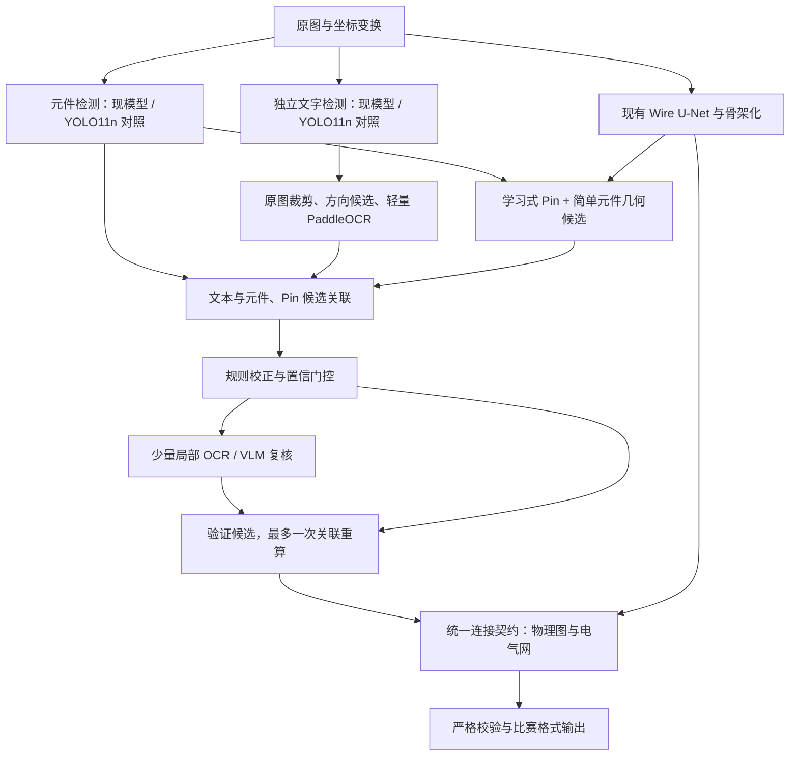

# PCBnet 论文驱动的项目架构优化建议

建议把项目升级为“可替换的视觉模型 + 统一候选与证据 + 确定性关联和构图 + 按需纠错”。优先投入文本检测、文本识别和 Component→Pin 的召回链路，复用已经存在的 Circuit-IR、坐标变换、导线分割、图构建与严格校验。新增模型作为对照候选，通过本地端到端实验后再决定是否进入正式模型锁。

依据是用户提供的 [PCBnet 论文 PDF，第 2–4 页](E:/我的文档/Downloads/2608.27923v1.pdf)，以及本次重新读取的项目代码。论文发表于 2026-08-28；论文标题与版本可在 [arXiv 页面](https://arxiv.org/abs/2608.27923)核对。本报告延续现有硬件约束，附带的 [Agent 实施 Prompt](E:/EDA挑战题目六/docs/PCBnet论文优化AgentPrompt_2026-09-08.md)可逐项交给其他 agent 执行。

**一、论文真正支持哪些选择**

论文第 2 页的方法分为三部分：YOLOv11 检测元件和文字、PaddleOCR 识别文本、U-Net 提取导线；通过几何邻接、类别与布局约束构建连接；用知识规则、LLM、局部图像 VLM 和元件配对修正低置信文本。Pin 根据元件类别和几何布局估计，论文没有提供独立 Pin 神经网络的详细设计。

第 4 页的结果应这样解读：

| 论文实验 | 表列 ACC | 相邻步骤增量 | 对项目的启示 |
|---|---:|---:|---|
| 整图 PaddleOCR | 78.65% | — | 整图背景与密集布局会影响文字识别 |
| YOLO 定位 + PaddleOCR | 93.67% | +15.02 个百分点 | 首先验证文字定位、裁剪和成熟识别器的组合 |
| 再加知识引导 LLM | 95.93% | +2.26 个百分点 | 低置信候选可利用命名与字符混淆知识 |
| 再加局部图像纠错 | 97.48% | +1.55 个百分点 | 保留裁剪图，给少量难例二次识别 |
| 再加元件配对 | 98.57% | +1.09 个百分点 | 文本内容与归属需要共同判定 |

这些数值来自表 II、III。后面三项是累计消融，论文没有给出每项独立的时延、调用费用或网表收益。最大的表列增量来自文字定位，但这不意味着任意检测器加到任意 OCR 前都会提高精度：表 II 中 Tesseract 的 CER 从 22.34% 恶化到 50.84%，与正文“所有方法均改善”的概括不一致，应以逐行实验结果为准。

还需保留四个比较边界：

- 表中所有 OCR ACC 数值都恰好等于 `100 − CER`，作者没有明确给出 ACC 公式。因此 98.57% 不能直接解释为设计标识、Pin 编号或整条文字的完整匹配率。
- 94.54% 的元件 mAP 没有明确 IoU 设置；93.70% 是 Wire IoU；84.47% 的 connectivity accuracy 对误连和分母的定义不足。三者都不能直接替代本项目的 mAP50、Pin/Net F1 或比赛成绩。
- 论文使用 RTX 3090 / Core i9，但没有披露 YOLO11 的 n/s/m/l/x 型号、输入尺寸、batch、训练耗时和显存峰值。下文选择小模型和微批是针对本机的工程建议，不能声称复现原论文配置或精度。
- 本地 Dataset300 与论文 PCBnet 尚未通过文件清单、哈希及标注统计确认同源。论文 PDF 和本次查阅的 arXiv 摘要页没有明确的项目代码链接，不能假定已获得作者权重、split 或可直接运行的 baseline。

**二、当前代码已经具备的基础，以及仍需补上的部分**

本次读取时，正式 [模型锁](E:/EDA挑战题目六/models/models.lock.json)仍使用 Component v5、旧 OCR resume、Pin v5 与 Wire v5。表中的指标来自各冻结模型的验证记录，评估范围不同；用途是识别内部瓶颈，不能与论文百分比直接作差。

| 模块 | 当前证据 | 架构调整 |
|---|---|---|
| Component | 模型卡 `mAP50=0.2501`；现有多尺度 tile、NMS 和回退门控 | 增加 YOLO11n 对照适配器；保留统一后处理，固定 OCR/Pin 后比较 |
| OCR | 冻结 detector recall `0.2726`、Hmean `0.3669`；识别 normalized exact `0.5307` | 把检测与识别解耦，分别验证 YOLO 文字检测、PaddleOCR 和裁剪质量 |
| Pin | 模型验证 precision `0.8508`、recall `0.5098`；发布配置每元件最多 12 个候选 | 保留学习式 Pin，增加有图像证据的简单元件几何候选；审计高引脚数 IC 截断 |
| Wire | 模型验证 skeleton F1 `0.9402`，connectivity score `0.5789` | 优先检查 Pin 接入、交叉点与错误桥接，扩大 U-Net 暂不列为首选 |
| 关联和推理 | 已有类别规则、候选证据和预算路由；推理默认关闭 | 接入文本质量评估、候选补全、局部纠错与关联重算 |

复查还确认了上一轮之后的增量，后续 agent 应保留并继续验收：

- `RUN` 与两个有独立 owner 证据的 `R1`，在本次合成探针中已可保留；不能继续描述为这些用例仍被全部拒绝。
- 共线重叠、5 px 间隙在校验器收到匹配容差时已不再报断连；但“远处两段线复用同一 source polyline ID”的非法单网仍未被校验器拒绝。构建器此例产生两个网，校验器还需要独立检查真实几何证据。
- [Pin ONNX 适配器](E:/EDA挑战题目六/src/pcbparse/perception/torch_pin_adapter.py:312)已加入实际 session provider 检查；显式 CUDA 请求不能再仅凭 available providers 判断成功。这是错误检测修复，尚不等于 CUDA 依赖问题已解决。
- OCR 的 global/component/strip 批量已由配置控制，感知子阶段计时已加入。跨元件 ROI 重复文字出现 owner 冲突时，当前代码会清空硬 owner 并保留候选上下文。

上述是当前代码和合成样例的结论。本轮没有重跑模型训练或新的 release50；8 月严格流水线 `0/50` 的旧结果只作为历史问题证据，不代表这些修改之后的新成绩。复查哈希与探针保存在 [本轮 evidence.json](E:/EDA挑战题目六/artifacts/audits/pcbnet_paper_review_20260908/evidence.json)。

**三、建议的目标架构**

图中是逻辑数据依赖。本机执行时保持一个 GPU 工作队列，按阶段顺序运行。所有适配器继续返回现有 IR 对象，并保留模型版本、原始文字、候选、坐标变换、crop 标识和证据来源。

**优先改造 1：把 OCR 变成可组合的两段链路。**

当前 [OCRProvider](E:/EDA挑战题目六/src/pcbparse/perception/protocols.py:43)的对外接口已经稳定，可以保持 `recognize(views, ctx) -> TextToken[]`；在其内部新增 TextDetector 与 TextRecognizer 组合。现有 [TorchOCRAdapter](E:/EDA挑战题目六/src/pcbparse/perception/torch_ocr_adapter.py:143)也包含检测和识别两个模型，但目前与同一 bundle 的预处理、字符集和解码逻辑绑定，第三方识别器不能直接替换。

先做四组对照：旧检测器+旧识别器、旧检测器+PaddleOCR、YOLO 文字检测+旧识别器、YOLO 文字检测+PaddleOCR。再单独加入方向复核与局部补检。使用同一验证集、同一坐标恢复和后处理，分别测检测 recall、GT 裁剪识别 exact/CER、预测裁剪端到端 exact，确定漏检、裁剪损伤、字符识别各自的贡献。

文字检测必须保留全局覆盖，避免元件漏检后连对应文字也失去入口；全局覆盖可由重叠 tile 实现，不应把大图强制缩成一张小图。元件 ROI 与 Pin 侧边条带改为条件补检：已有高质量文字覆盖的区域跳过重复检测。当前三层均执行的路径作为 baseline 留存，门控效果需要单独消融。

识别器先试轻量 `PP-OCRv5_mobile_rec`；以拉丁字符为主的裁剪可把 `en_PP-OCRv5_mobile_rec` 作为第二候选，但须检查 Ω、µ、下划线及特殊 Pin 名的字符覆盖。官方文档列出的模型存储分别约 16 MB 和 7.5 MB，存储体积不等于运行显存；这两个具体版本是本项目候选，论文没有指定它们。[PaddleOCR 识别模块文档](https://www.paddleocr.ai/main/en/version3.x/module_usage/text_recognition.html)

对竖排或低置信裁剪保留原方向和 90° 方向候选；记录方向变换，输出坐标始终回到原图。宽度分桶后微批识别，长文字不静默截断。当前实现每批按最大宽度补齐，最高允许宽度 4096；这是可以先优化且容易验证的内存开销。

**优先改造 2：把文本内容、角色与归属一起判断。**

论文的类别前缀、水平/垂直对齐和局部唯一性，本项目已经实现了不少基础规则。新增重点应是统一候选评分，综合 detection confidence、recognition confidence、字符形态、类别、距离、方向和 owner 证据，并保留“未关联”选项。候选稀疏图上按连通分组做全局指派，避免全图大矩阵。

语义分组应至少区分 designator、value、器件型号、Pin number、Pin name 和 net label。同一元件可同时有标识与数值，唯一性应按字段和实物文字实例定义。相同字面 `R1` 出现在两个不同位置，不能当作同一物理文字；ROI 裁剪来源也只能提供关联证据。`RUN`、`VCC` 等既可能有元件语义也可能是网络标签，应由图像、标注类型与局部布局判定，不能只凭前缀写入 key。

落实入口是 [文字关联](E:/EDA挑战题目六/src/pcbparse/association/text_component.py)、[语义字段](E:/EDA挑战题目六/src/pcbparse/association/semantic_fields.py)和 [多层 OCR 合并](E:/EDA挑战题目六/src/pcbparse/perception/ocr_multilevel.py)。Pin 文本已有全局匹配逻辑，先复用其约束和证据表达，不重复创建第二套 matcher。

**优先改造 3：用轻量检测对照与几何候选提高上游覆盖。**

元件检测增加独立 YOLO11n 适配器，保持 ComponentProvider、tile 坐标、类别映射和 NMS 不变。YOLO11n/s 的官方参数量约 2.6M/9.4M，因此先从 n 开始；s 仅在实测显存允许且 n 的误差确实需要容量时尝试。这些是通用模型规格，不能推导 PCB 检测成绩。[Ultralytics YOLO11 文档](https://docs.ultralytics.com/models/yolo11/)

论文没有说明元件检测与文字检测共享权重，第一版保持两个任务适配器。共享 backbone、多任务联合训练、YOLO-pose 同时预测 Pin 均作为后续研究方向，需要先解决标签映射、不同输出和缺失标注，避免一次改变多个变量。

Pin 增加 HybridPinProvider：对明确的两端元件，根据符号方向生成少量端点候选，再用原图笔画、元件边界与 wire mask 支持筛选；复杂 IC 继续依赖学习式 Pin 和边界证据。几何候选不得自动编造 Pin 名、编号，也不得仅由 bbox 中点直接连网。融合时记录 learned/geometry 来源，合并重复候选，再做 owner 与 Pin—Wire 接入判定。

当前全类别 `max_detections_per_component=12` 值得单独审计：统计不同类别截断前候选数、真实 Pin 数和误检，针对高 Pin 数 IC 设置可验证的上限。历史实验已经表明，简单扩大 ROI 或放宽候选门控会恶化 Graph，所以更高的候选数量必须伴随更好的证据筛选。

**优先改造 4：把已有 selective reasoning 补成论文式纠错闭环。**

[任务生成器](E:/EDA挑战题目六/src/pcbparse/reasoning/tasks.py:36)目前只处理空字段，且要求上游已提供至少两个候选；[推理入口](E:/EDA挑战题目六/src/pcbparse/reasoning/orchestrator.py:26)仅允许选择候选填入空字段或消解交叉点。直接把 `qwen.enabled` 打开，无法覆盖“字段已填写但 OCR 读错”“原候选集中没有正确字符串”的论文场景。

建议在上游增加版本化 TextHypothesis 证据，保留 raw、top-k、字符混淆生成候选及修正提案。先用小型规则文件表达 `0/O`、`1/I/l`、编号和数值格式、类别兼容及常见错误，无需先建设向量数据库。候选仍不足时，二次 OCR 或局部 VLM 可提出新候选；新候选经视觉、字符集、字段格式与归属检查后才能进入决策层。

门控不能直接比较 OCR 分数与 VLM 自报置信度，两者未必同尺度。应在开发验证数据上校准“是否值得重读”和“是否接受改写”，同时报告改对、改错、拒绝与未覆盖数量。已有高置信字段继续保护，低置信非空字段通过显式提案比较，不开放任意 IR 修改。

当前 [流水线](E:/EDA挑战题目六/src/pcbparse/pipeline/orchestrator.py:205)把推理安排在构图前，这是合理基础。若今后改写了原始文本或 owner，需重算受影响的文字关联，再构建物理图和电气网；最多一轮纠错，防止规则与模型反复覆盖。若只填入已有对象的空字段，则按字段依赖决定是否重算，避免所有操作都全图重跑。

先保持发布配置的预算：每图最多 3 次调用、输入合计 3000 token、单次输出 64 token、超时 12 秒。记录调用收益、预算耗尽与缓存命中；字段范围扩大导致 64 token 不够时，应明确修订结构和预算后再评估。大量漏检仍需视觉层解决，少量纠错调用无法补齐成批缺失字段。外部推理应保持可关闭并沿用项目已配置、允许使用的服务，纯本地链路能够独立运行。

**优先改造 5：让拓扑改进围绕真实连接证据。**

保持现有 WireProvider、骨架化、junction 与物理/电气网层。论文仅给出距离阈值公式，没有解决本项目跨 tile 重叠、断线桥接、交叉不相连和 source ID 复用的完整契约。此处应优先复用 [物理图代码](E:/EDA挑战题目六/src/pcbparse/graph/physical.py)与 [校验器](E:/EDA挑战题目六/src/pcbparse/validation/graph.py)，抽出双方共同采用的邻接规则和证据要求。

同 source ID 只用于溯源，不应让远距离线段免于几何检查；间隙修补需有原图、mask 或可验证路径支持。交叉点必须区分有结点连接与无结点跨越。对问题 crop 保存“模型 mask→骨架→Pin 投影→网络”的中间结果，分别做 oracle Pin、oracle wire、oracle text 诊断；GT 替换只进入标明用途的离线分析，不能出现在生产推理。

**四、适合当前硬件的落地方式**

此前硬件观测为 i5-12500H、16 GB RAM、RTX 3050 Ti Laptop 4 GB；本轮 GPU 快照已占用 2068 MiB，E 盘可用约 25.45 GiB。占用会变化，应在每次实验启动时记录。参考 [硬件记录](E:/EDA挑战题目六/artifacts/audits/architecture_review_20260908/hardware_runtime.json)与本轮 evidence。

| 环节 | 首轮建议 | 调整依据 |
|---|---|---|
| GPU 调度 | 只运行一个训练或推理工作进程 | 开始前采样空闲显存，给系统及其他程序留余量 |
| YOLO 对照训练 | 预训练 n 模型；512 tile；batch 1；梯度累积 8；workers 0 | 先完成数个 batch 的数值和显存烟测，再尝试 640 或更高批量 |
| PaddleOCR 接入 | 独立环境，先对缓存裁剪做 CPU 识别 | 测 exact/CER、CPU 时延和 RAM，再决定是否转 ONNX/GPU |
| 推理批量 | Component/Wire 从 1 起；Pin 从 4 起；OCR 按宽度分桶 | 以上是实验起点，不替换现有配置，也不保证一定装入当前空闲显存 |
| 精度模式 | FP32 基线，按模块比较 AMP/FP16 | 现有 Component 微调曾出现 FP16 非有限损失，不能统一强开半精度 |
| 模型驻留 | 先测总驻留成本；超预算时按阶段加载、释放 | 避免 PyTorch、Paddle、ORT 同时各自建立大 GPU 内存池 |
| 缓存和磁盘 | 复用预测裁剪与 IR；仅为新实验保留 best/last；新增产物先限 8 GB | 不自动删除旧模型或用户文件，定期检查剩余空间 |
| 局部大模型 | 只验证少量高价值疑难 crop | 本机优先把资源留给检测、识别和连接重建 |

推理进程显存预算可从 `min(2800 MiB, 启动前空闲显存 − 512 MiB)` 起步，同时采样设备总占用、PyTorch allocated/reserved 和 ORT 会话信息；不同框架的峰值不能靠模型文件大小估算。可用空间不足时先降低 batch 或用 CPU 跑缓存实验，不能把 4 GB 全部视为本进程可用。

新增 ONNX 模型之前需要先确定一个实际能执行的运行栈。当前运行审计里的“ORT 1.22+ 都与 CUDA 12 不兼容”不准确：官方矩阵列出 1.21.x–1.26.x 为 CUDA 12.8 / cuDNN 9 构建，1.27 起默认 CUDA 13；同一 CUDA 主版本存在小版本兼容。隔离环境选择精确版本、检查导出模型的 IR/opset、预加载匹配 DLL，并完成实际 session 和代表性推理验证后再登记。不要仅因包列表包含 CUDAExecutionProvider 就宣告 GPU 已修复。[ONNX Runtime CUDA 文档](https://onnxruntime.ai/docs/execution-providers/CUDA-ExecutionProvider.html)

**五、按实验结果逐步合入**

| 顺序 | 交付物 | 进入下一阶段的依据 |
|---|---|---|
| A：刷新基线 | 当前代码/配置/模型哈希、运行设备、分域与分字段指标 | 旧结果与新结果可区分；已知连通反例有准确状态 |
| B：OCR 四组对照 | 组合适配器、裁剪缓存、检测/识别/端到端分解报告 | 真实图像中关键字段 exact 提升，解释漏检变化和误改 |
| C：关联改进 | 候选角色与 owner 统一评分，局部全局指派 | 归属准确率、Pin 编号 exact、严格输出成功率改善 |
| D：Component + Hybrid Pin | YOLO11n 对照、几何候选及高 Pin 数分析 | owner-aware Pin recall 和 Net 指标获益，误连没有被忽略 |
| E：局部纠错 | 规则候选、门控校准、调用与改写账本 | 正向改写多于负向改写，固定预算内端到端有净收益 |
| F：整合复验 | 候选锁、相同 evaluator 的对比、时延/内存与失败清单 | 严格有效性通过，质量和资源结果共同支持正式切换 |

表中顺序表示集成依赖；独立代码工作可以分工，但本机 GPU 实验应排队。性能优化和图连接契约修复可先在缓存与 CPU 合成样例上完成。

release50 已包含原 test 的 30 张与 val 的 20 张，并已用于多轮调优，适合作为回归集。把它重新命名为“新测试集”不能恢复独立性；新选择应固定开发协议，最终尽量使用未参与选型的新增设计或明确标为内部验证的分组交叉验证，且同源工程族不能跨组。

评估复用 [现有比赛指南指标实现](E:/EDA挑战题目六/src/pcbparse/evaluation/official_metrics.py)，补齐与指南一致的逐案例汇总；其当前 aggregate_reports 是计数汇总，不能直接当作赛会逐案例平均。至少同时报告：Component 几何与语义、Pin owner/point/number/name、Net 集合匹配、Wire 几何、字段 missing、严格输出成功率、分域结果、P50/P95、内存峰值和 token。失败样本必须计入分母；保留诊断 IR，避免只分析成功输出。

建议第一轮选型的工程门槛是：同一开发集关键字段 exact 至少提升 5 个百分点或 missing rate 相对下降 20%，同时报告原始样本数；高影响字段误改率、Net F1、严格有效性不得出现未解释退化，P95 与资源占用在预设预算内。这是用于决定是否继续投入的建议门槛，不是论文指标、预测收益或比赛官方要求。若达不到，就按检测、裁剪、识别、关联四层误差回退定位，暂不增加模型规模。

本轮完成的是论文阅读、架构对照、当前代码探针与实施设计，未安装新框架、替换模型锁或执行训练。按照以上顺序，首先值得让 agent 落实的是 OCR 组合适配器和四组对照；它既有论文消融依据，也直接对应当前冻结模型的低文字检测召回。
