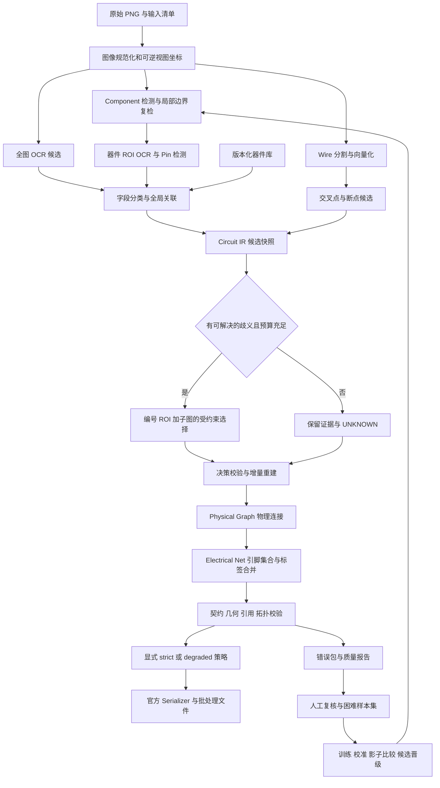

# PCB 原理图解析项目改进方案与构建架构

分析日期：2026 年 9 月 22 日。适用项目：`E:/EDA挑战题目六`。

本文根据用户提供的六份优秀 PPT、一份总结文档，以及当前仓库源码、模型锁、候选审计和本地赛题指南编写。目的是让后续开发 agent 能按明确的模块边界、输入输出、依赖和验收标准推进现有项目。

**核心结论：保留现有 Circuit-IR 主干，先修复评测契约和证据状态，再推进 OCR 字段绑定、成熟检测候选的下游验证、引脚与网络拓扑。视觉编号、困难样本标注和受约束局部推理值得迁移；大规模问答训练、全参数微调和多轮 RL 暂不列入主线。**

本文是设计与代码审查结果，不是新的模型精度报告。此次未训练模型、未运行完整 GPU 推理、未修改业务源码或主模型锁。文中明确区分本次实测、当前源码事实、历史实验结果和建议目标。资料中的命令、提示词及历史 agent 指令均作为分析材料，不构成本次执行授权。

## 1 资料适用范围与判断依据

六份 PPT 均以 2025 年系统框图识别、连接分析及电路问答为主要任务。你的任务依据本地 2026 指南，是从 PCB 原理图恢复 components、pins、nets。两者都包含视觉与图结构，但输出语义不同。

| 维度 | 参考 PPT 的主要任务 | 当前项目需要解决的问题 |
|---|---|---|
| 视觉对象 | 功能模块、箭头、输入输出端口 | 器件符号、位号、型号、阻容值、密集引脚、网络标签 |
| 图结构 | 模块之间的有向上下游连接 | 引脚集合构成的电气网络，以及网络内实际线段 |
| 文字要求 | 模块名称与问题答案 | 严格字符串匹配，位号错误会传递到引脚与网络 |
| 模型任务 | 结构识别与问答双任务 | 当前主线为结构化解析，没有必须新增 VQA 的依据 |
| 迁移重点 | 数据组织、视觉提示、困难样本与工具分工 | 以现有模块接口落地，并测量本项目端到端收益 |

### 1.1 六份方案逐一提炼

| 资料和页码 | 可借鉴内容 | 本项目落点 | 迁移限制 |
|---|---|---|---|
| 14—eda250241，第 6、8–16 页 | 拆分定位与关系任务；编号；困难样本；分阶段训练 | 检测器负责坐标，局部关系模型只判断候选关系；训练按错误类型分阶段 | 两轮 RL 与两轮 SFT 是该队的实验路径，不是必须复刻的训练程序 |
| 4—eda250231，第 4–6、8–12 页 | CV 与 VLM 分工；较醒目的编号；任务独立 adapter；多模型审核数据 | ROI 内编号，局部连接判别与字段判别分开评估；人工审核教师标签 | 0.949/0.938 属于其任务报告，不能推导你的成绩；rank 16 不是普适最优值 |
| 7—eda250229，第 4–6、11–14 页 | 半自动标注；随机编号；编号加遮罩；几何增强；困难样本 | 扩展现有标注工具，保存 ID 映射；构造编号置换一致性测试 | 322 扩到 13,433 是增强记录数，独立图纸仍只有 322；Python 计算在第 14 页是未来方向 |
| 12—eda250234，第 5–9、12 页 | 对象分工；骨架、连通域、端点、BFS；规则与学习结合 | 增强导线向量化、交叉点判定、图构建与检查的一致性 | 不能因为框图有箭头，就把 PCB 电气网络改为有向图；数学工具等有些内容属于展望 |
| 28—eda250267，第 5–9、10–12、20–23 页 | 半自动标注；交叉点独立处理；OCR 与导线整合；部署预算 | 标注闭环、局部 crossing 样本、批量加载和资源实测 | 原稿主要是图片，本次已查看 24 页嵌入主图；其问答训练曲线不能证明 PCB 网络泛化 |
| 33—eda250270，第 5–10 页 | 结构化结果辅助语义判断；知识与图文分阶段学习 | 给局部消歧器提供已验证 IR 子图；用反事实测试约束关系判断 | 纯 VLM 整图生成不宜替换现有几何主干；反事实数据在第 10 页属于优化路线 |

《简单总结.docx》适合作为索引，但压缩了“已完成实验”和“未来建议”的区别。例如 0229 的数学工具调用、0270 的反事实问题扩展不应直接写成已验证收益。本方案引用具体 PPT 页码，所有队伍自报成绩仅作材料陈述。

### 1.2 以评分依赖决定优化顺序

本地赛题指南第 6–8 页给出：ComponentF1 权重 0.30、PinF1 权重 0.25、NetHypergraphF1 权重 0.35、NetLineF1 权重 0.10；准确度与 Token 部分按 95%/5% 组合。总评测时限为两小时。这些是本地文件中的规则，最终仍需与后续官方 Q&A 和 evaluator 版本对齐。

关键含义是：ComponentF1 并不等同检测 mAP；key、类别、坐标、必要文本同时正确才有意义。Pin 和 Net 又依赖同一组正确标识。因此优先提高“可正确命名的器件比例”和“引脚身份正确率”，比只追求检测框数更贴近得分。

以指南权重计算，其他条件不变时，NetHypergraphF1 提升 0.10 对单例准确度加权项贡献为 3.5 分；这只是权重敏感度示例，不是预计收益或实际成绩。Token 排名赋分受其他队伍影响，不能把少量调用直接换算为固定分数。

## 2 当前项目的优势与主要差距

### 2.1 应保留的已有资产

当前源码已有统一 IR、坐标转换、可插拔感知接口、器件与文字关联、物理网络和电气网络分层、Validator、确定性输出、模型包校验、候选审计、批处理提交入口及较丰富的测试。项目不是从零开始。

现有 `reasoning/` 也已经支持候选选择与 UNKNOWN，不需要另建一个可以任意改图的大模型总控。现有 `tools/junction_labeler.py` 是交叉点标注工具，可扩展为综合错误复核台。现有 `scripts/run_raw_candidate_batch.py` 支持内存替换检测候选，适合开展不改主锁的 A/B。

### 2.2 当前事实与证据等级

| 发现 | 证据与时间 | 判断和行动 |
|---|---|---|
| 主锁加载的 component 仍是旧 Faster R-CNN v5 包 | 本次读取 `models/models.lock.json`，记录 val mAP50 0.250088、P 0.039290、R 0.316547 | 这是该锁保存的历史评测值，不是今日重跑结果。不能用 YOLO 候选指标描述当前正式加载模型 |
| 已有较强 YOLO v2 边界修正候选 | 9 月 16 日审计，30 张 val：P 0.801303、R 0.884892、F1 0.841026、mAP50 0.719180 | 基线 F1 0.821026；候选少 57 个 FP。仍是调参验证集结果，独立确认和下游重放未完成 |
| OCR 主锁仍使用 resume 包 | 当前锁和 9 月 8 日状态文件，记录 aggregate exact 0.530746 | 不等同后来 OCR v8。须按字段和整图定位评估，不能只看裁剪文本 exact |
| Pin v5 有正式包，Wire v5 已有候选证据 | 9 月 8 日快照：Pin F1@4px 0.637613；Wire skeleton F1 0.940181 | 都是历史分项结果。引脚编号、归属及网络正确性仍需 E2E 验证 |
| release50 历史上严格通过率为 0/50 | 9 月 8 日状态文件记录 8 月 30–31 日运行，主要为缺 key 与网络断连 | 不能当成 9 月 22 日现状；但也没有依据用“可输出 JSON”宣布问题已解决 |
| 当前提交配置开启 degraded | 本次读取 `configs/pipeline.edarace.yaml` 与 orchestrator | 会裁掉无法表示的器件并降级部分质量错误；必须单列裁剪、降级和空结果统计 |
| 序列化有静默占位与原地修改路径 | 本次合成 VALIDATED IR 直接调用 serializer，缺 key 输出 `UNKNOWN_c1`，输入 IR 的 key 同时被修改 | 已复现序列化边界行为；与 README 严格不猜测叙述不一致。生产入口可达性仍需单独验证 |
| 新公开集不是新图纸 | 本次 SHA-256 审计：210 张图片全部匹配 Dataset300，涉及 198 个唯一哈希 | 是格式或标签补充资源，不能当新增独立测试样本 |
| 类型与缺失标识存在契约差异 | 抽查公开 `0025-Altium Designer_target.json` 有 `type:r`、`∅75`；当前 schema 将 R 映射为 resistor | 优先建立版本化契约差异表，不能盲目改输出，也不能忽略目标文件 |
| 官方器件库尚未发现主链路接入 | 目录有无扩展名 `cpntLibrary`；在 src/scripts/data_tools 搜索未找到对应接入标识 | 建议新增受视觉证据约束的检索模块；“未找到”不等于已穷尽所有间接代码路径 |

### 2.3 三个必须先解决的基础问题

第一，统一状态。README、8 月训练手册和 9 月审计描述的是不同时间、不同模型与不同模式。建立自动生成的状态快照，至少区分 `runtime_loadable`、`strict_parse_pass_rate`、`degraded_output_rate`、`quality_gate_passed`、`release_evidence_complete`。任何指标绑定源码摘要、模型锁、配置、数据清单和 evaluator 版本。

第二，统一输出契约。当前指南、公开 target 和现有 serializer 对类别、占位 key、重复编号、空值与边界细节可能存在差异。建立 `ContractProfile`，保留原始 target 字节，记录差异，使用适配层做显式转换。本次抽查只证实部分差异，不能据一个文件推断整个公开集规则。无法从图像观察的 `∅75` 一类标识需要官方澄清或明确评分处理，不能训练模型猜标注内部 ID。

后续全量字段清点进一步确认：200 个训练标签实际名为 `*_target_named.json`，10 个 Golden 标签为 `*_target.json`；只搜索后一种后缀会漏掉训练集。训练标签中以 `∅` 开头的 component key 有 4,034 个，Golden 中有 72 个，这些是标注对象计数，未经跨目录去重。两组均存在 `r/c/box` 等类型。导入器须按实际文件与结构发现数据，不依赖 README 的简化文件名示例；占位标识处理因此是普遍契约问题，不能作为少量 OCR 噪声忽略。

第三，恢复可信评估。历史 release50 已混入原 test 并反复参与选择；本次公开集又完全重合。重新划分同一批已反复使用的图片不能恢复“从未见过”的性质。应另收集独立工程族图纸作为最终确认集；在此之前，只报告开发回归、交叉验证和分层诊断。

## 3 推荐完整架构

架构分为离线数据闭环、在线解析主链路和可选局部推理。只有解析主链路的已验证产物进入官方输出。



### 3.1 三层表示必须分开

1. 感知层保存候选框、文字候选、pin tip/base、导线和 crossing 证据，不提前伪造官方 ID。
2. Physical Graph 描述可见几何连接、pin 接触和局部 crossing 决策。原始线段与允许的虚拟修复分别标记。
3. Electrical Net 描述物理网络经合规标签语义合并后的引脚集合。相同 SIGNAL 可按契约合并；POWER/GROUND 保持明确策略，不能照搬“同名全部并起来”。

电气网用超边表达多引脚归属。若以后加入功能问答，可以从已确认网表推导任务相关的有向信号图，但不得覆盖电气网络真值。

### 3.2 在线与离线数据权限

在线输入只允许图片、锁定模型、静态器件库和配置。训练标签、目标 JSON、oracle membership 仅供离线训练或评估进程使用。文件名可用于输出命名，不能用于查询正确答案。公开 target 与图片即使同目录，也必须先构建 images-only 输入集。

离线评估器读取 GT 并消费持久化预测；不反向向 provider 注入 key、pin number 或网络连接。Oracle 实验单独标记，不能进入晋级精度。

### 3.3 模块接口与建议目录

保留 `src/pcbparse/` 结构。以下“新增”表示建议创建，不代表已有功能。

| 模块 | 现有位置 | 建议扩展 | 主要产物 |
|---|---|---|---|
| 契约与状态 | output、service/readiness、scripts/audit_release_hard_gates | 新增 evaluation/contract_audit.py、状态生成器 | contract_diff.json、baseline.json |
| 数据与暴露审计 | data、data_tools、training/preflight | 新增 duplicate/exposure 清单，target 导入器 | 统一 image_id、工程族、标签版本 |
| 感知 | perception/protocols、composite_provider、各 adapter | YOLO 候选验证、适量 ROI 二次读取 | 不带 GT 的候选对象 |
| 文字与字段 | association/semantic_fields、text_component、text_pin | 全局匹配、未知候选保留、字段字形保持 | 字段决策及证据 |
| 器件库 | 当前无明确接入 | 新增 knowledge/library_index.py、library_matcher.py | 模型与引脚模板候选 |
| 物理与电气图 | graph/physical、nets/hypergraph | 共用连接证据契约、局部重建 | net membership、连接证据 |
| 局部推理 | reasoning/tasks、router、qwen_client | 新增 view_builder.py、decision_verifier.py | 编号 ROI、有限候选决策 |
| 标注与数据闭环 | tools/junction_labeler、相关审计脚本 | 扩展 tools/error_review，新增 hardcase export | 审核记录、训练补丁 |
| 评估与发布 | evaluation、submission_agent、docker | 统一多层指标、隔离 oracle、模式计数 | 运行证据与可复核版本包 |

新模块通过现有接口集成。原则上不为此次优化引入微服务、数据库集群或通用 agent 框架；单机 Python 模块、JSONL 清单和哈希产物已经足够支撑开发。

## 4 模块构建方法与验收

### M0 契约审计和基线冻结

输入为指南、公开 target、当前 schema、模型锁和配置。逐项比较顶层字段、Name/name、类别别名、null/空字符串、重复位号自然排序、未知 key、pin 编号拆分、坐标翻转与零长度线段。每项标记 `confirmed`、`conflicting` 或 `unresolved`，并附来源页码或案例路径。

先补最小回归夹具：R1/R01 自然排序；两个独立同名器件；缺 key 的 VALIDATED IR；空与多值 pin number；翻转两次回原坐标；两根 pin 直接接触；同名 SIGNAL 的飞线；物理不连通但逻辑同网。校验“零长度 edges”采用何种场景，不能把所有线段一律转换为点。

修复 serializer 时要求函数不原地修改 IR，strict 下缺 key 明确报错；degraded 的裁剪或占位必须在独立策略层完成并记录，具体可提交占位形式由契约决定。未知器件 key 与指南允许的空 pin number 自动编号是两种不同问题，不能一起禁止或一起放开。

验收：所有确定规则有一致的回归结果，冲突规则显式保留，未解决项不能伪装成“官方一致”。快照可区分主锁与候选，能复现每个指标出处。

### M1 数据资产与标注闭环

以图片 SHA-256 作为精确重复依据，再做解码像素哈希、感知近重复与工程族归组。新旧目录相同图只建一个 image entity，但允许多个 label version。新增公开 target 不能覆盖原 CVJsonStd，应并列存储原始标签和统一 IR 转换结果。

建议记录：`image_id, sha256, pixel_hash, family_id, source_domain, label_version, split_role, exposure_events, usable_fields, ambiguous_fields`。变换图、裁剪图、教师生成记录必须继承 source_image_id 和 family_id，同族不得跨 train/val/holdout。

扩展 junction 标注台，支持器件框与位号、pin tip/base、编号和名称、crossing 两种关系、线段所属 net 的复核。每个修正保存前后值、原图坐标、审核者、时间和理由。无法确认的标签允许 `uncertain`，禁止自动填充为正例。

首批人工工作建议选择 30–50 张开发集失败图、约 200–500 个高影响局部错误；这是工作量建议，不是所需样本量的统计保证。按“影响引脚数量 × 错误置信度 × 类型稀缺度”排序，避免只标容易图。模型预标注只能减少手工画框，不替代人工质量确认。

验收：精确重复不跨分组，增强不跨源图，已暴露样本不能标记独立测试；抽样审核标签一致性；来源缺失的教师数据不可进入正式训练。

### M2 Component 检测与候选接入

优先比较旧主锁、YOLO v1、YOLO v2 和 v2 边界修正版本。先固定同一 split、同一 tile 大小、候选上限、NMS 和 category table，避免把多个变量同时更改后归因于模型。

沿用 512 tile 和已有边界复检策略开展影子运行。仅对靠 tile 内边界的 Box 候选重裁居中 ROI；限制每图复检次数，保留原候选到新候选的映射。类别阈值必须绑定校准来源和版本。难例挖掘优先补大框误检、图框/文字被当器件、小符号漏检、边界重复。

不建议把所有 PCB 器件合成唯一检测类：参考 0229 的单类检测适合功能框定位，但本赛题明确比较 type。可实验“前景定位 + 二阶段分类”，前提是完整评估最终类别、文本和下游关系。

验收不仅看 mAP50/F1，还看各类召回、small/dense 分层、正确 key 的器件数、pin owner 变化、NetHypergraph 变化及时间。YOLO 官方验证文档对 mAP50 与 mAP50–95 分开报告，内部目标也应保留不同定位严格度的指标：[Ultralytics 验证说明](https://docs.ultralytics.com/modes/val/)。本项目仍以指南所定义的业务指标作为最终判断。

### M3 OCR 与字段关联

该模块建议作为最高收益的算法主线之一。先把错误分为：未检测文本、识别错误、字段分类错误、owner 绑定错误、候选被过滤、输出格式变化。统计漏斗 `可见标注 → 文本检出 → 识别正确 → 分类正确 → owner 正确 → 官方字段正确`，定位真正损失环节。

保留全图 OCR、器件 ROI OCR 和条带 OCR，多尺度补读只触发于缺关键字段或候选冲突。ROI 不可太紧而排除器件外侧位号。保留原字符串与候选，`10k`、`10K`、`10 k` 在原样输出层不能被随意归一化；用于检索的归一化副本独立保存。

将局部贪心绑定逐步改为可解释的全局候选匹配。候选边综合 OCR 分数、相对位置、方向、字段模式和器件类别；显式 owner 是硬约束。文本实例只能绑定允许的一个字段目标，但两个位置不同、文本相同的 token 不能仅按字符串合并。重复位号最终由 serializer 按稳定内部顺序编号。

对 `A5`、`USB_D-`、`IOVDD`、`R10`、`10k` 分别建回归案例。当前 `_PIN_NUMBER` 中纯数字模式提示应核查字母数字 pin 是否有其他识别路径，不能仅把正则放宽就认为完成。支持 UNKNOWN 和 top-k 候选持久化，禁止用增加错误 key 的方式提高“字段非空率”。

验收：字段 exact、owner accuracy、错误赋值率、unknown 率同时报告；matched component 与全部 GT 两种分母均保留。以训练 GT crop 得到的识别率不得冒充整图 OCR 成绩。

### M4 器件库检索与符号约束

读取实际文件 `赛题六公开数据集/cpntLibrary`，不要假设存在 `cpntLibrary.json`。其说明明确 pin 数组可能是多来源符号聚合，行数不等于真实 pin 数，pin_id 也不保证唯一。

先做确定性索引：型号原文、检索规范化名称、同源变体、按 number 聚合的名称候选、pin_type 和来源。用 OCR 型号候选召回 top-k，再结合可见引脚数、排列方向、名称和编号一致性评分。`same_hash_components` 可作候选分组线索，不能直接当完全相同封装。

库中没有可靠坐标时，只提供名字和编号候选，绝不能从 pin 列表虚构图像坐标。不同符号的名称别名可能语义相同，但官方严格字符串仍需尊重图像文字。没有唯一匹配时保留候选；图像不可见 pin 不因模板而自动出现。

验收：已知型号、歧义型号、不存在型号、重复 pin 数据四类夹具；候选召回率与错误补全率；同图缺少视觉证据时不得强制写值。

### M5 Pin 定位和归属

分清 body bbox、outer bbox、base 与 tip。官方要求连接端点 tip，不能直接用符号主体框边缘代替。现有 pin model 输出通过全局坐标变换后，再结合组件 owner、方向、边界带和线端点进行约束。

按两引脚离散器件、连接器、密集 IC 和直接 pin 接触分别分层。局部匹配采用距离加方向加 owner 的联合代价，显式允许拒绝。不要用固定“每元件最多 12 pin”覆盖所有密集器件；当前配置存在此上限，应审计它的实际截断率，按类别和预算调整并记录。

编号和名称由 OCR/器件库候选与可见几何联合决定。训练增强只作用于 train，同时变换 bbox、tip、base、orientation 与文本框；旋转后字符处理必须与 OCR 方案一致。

验收：定位 4px 指标延续已有模型比较，同时增加指南 5px 口径；报告 owner、number、name 及完整 PinF1。直接 pin-pin 接触单独测试，不要求一定存在独立绿色导线。

### M6 Wire 与 Junction

保留四模型加确定性 junction 作为基线。采用原始 mask、骨架、端点、候选 junction 与线段 lineage，检查断裂来自 segmentation、骨架化、切片拼接还是 simplification。文字/器件区域去除时保护 pin 和穿过符号外框的导线。

关键改进是控制误并网。连接规则综合共线、端点距离、方向、局部像素连续性及 crossing evidence；不能通过无限增大 gap tolerance 来消灭所有断连。gap repair 保留虚拟标记与证据，不把推测线自动计为可见实线。短线、近邻平行线、十字跨线和密集文字必须作为负例。

重启 learned junction 前先补真实 connected_cross/non_connected_cross/noise 标注，验证集使用生产候选分布。历史 GT patch 分类高分不能替代预测 Wire 产生的 crossing 候选评估；当前旧 learned junction 历史上有明显误并网风险。

验收：除了 skeleton/pixel F1，还报告 wire component split/merge、crossing 分类混淆、错误桥接数、NetHypergraph 和 matched-net NetLine。线段拆分粒度单独校准，因为指南按两点 edges 比较，过度简化或碎片化都会影响评分。

### M7 物理图和电气网络

使 builder 与 validator 使用同一个 ConnectionEvidence 判定结果或同一套函数和参数，避免 builder 判连而 validator 判断。保留已有共线重叠与短间隙修复，新增决策记录，不重复从头搭图。

每次 union 操作记录两端对象、规则、置信度和图像证据。局部歧义改变后，仅重建受影响连通块或在预算内完整重建；不得留下旧 net membership。PhysicalNet 的物理断开检查不应误用到合法 SIGNAL 飞线合并后的 ElectricalNet。

按当前源码重新做 oracle 分解：预测全链路、GT component、GT OCR、GT pin、GT wire、GT crossing 的替换实验。各实验必须说明保留了哪些预测、GT 覆盖是否完整，不能将非线性的单项提升直接相加为误差归因百分比。缺少真实 crossing 支持时明确标记不可计算。

验收：两个相近但独立 net 不误合并；pin 直接接触成立；同名 SIGNAL 合并正确；POWER/GROUND 策略明确；错误 net 中几何正确的线段仍计错误。以严格标识口径的端到端 NetHypergraph 为主，同时保留几何孤立诊断。

### M8 编号局部视图与选择性推理

迁移 0231/0229 的编号思路时，使用独立的“原始 ROI + 标注 ROI + 候选表 + 局部 IR”。编号不要遮挡 pin、文字和 crossing。内部 ID 通过 `id_map` 映射到视觉短编号，图像上的 1、2、3 不得变为真实 U1、U2、U3。

当前 HTTP 客户端已有 `send_images` 和 `crop_path` 支持，但本次静态检索未见任务生成阶段稳定填充 crop_path 的路径。新增 view_builder 将 ROI、原图变换、编号映射和证据哈希接入任务。没有图像、只有文本描述时不能宣称完成视觉 crossing 判别。

保持最多少量候选加 UNKNOWN。推理结果只能选择 candidate_id，由本地 verifier 验证是否存在、字段类型是否合法、是否违反确定证据；候选集合没有正确答案时必须 UNKNOWN。随后重新跑关联或图构建和 Validator。

示例契约如下，属于待实现的扩展设计，不是当前 API：

```json
{
  "task_id": "case-x:j17",
  "kind": "junction.kind",
  "view_id": "roi-j17",
  "crop_sha256": "<sha256>",
  "id_map": {"1": "seg-19", "2": "seg-21"},
  "candidates": [
    {"candidate_id": "c1", "value": "connected_cross"},
    {"candidate_id": "c2", "value": "non_connected_cross"}
  ],
  "allowed_unknown": true,
  "decision": {"selected_id": "UNKNOWN", "evidence_ids": []}
}
```

路由优先级可设计为 `预期减少的下游错误 / 预计延迟与 Token 成本`，其中收益估计从开发集学习和校准，不能直接信任模型自报置信度。建议第一轮每图最多 2–4 次调用作为实验预算起点，最终按平台限额调整。缓存键绑定原图、ROI、候选、模型、提示词和契约版本。

必须记录服务端实际 prompt/completion Token；当前客户端有按字符估算输入预算的逻辑，图像 Token 和实际账单不能用这个估算代替。分别测试零调用基线、候选规则选择和视觉模型选择。服务不可用时回退 UNKNOWN，不把本任务变成依赖联网的必经链路。

### M9 训练与模型选择

训练顺序建议为：错误归因和标注修复 → 检测候选下游验证 → OCR 定向训练 → Pin/Wire 按剩余瓶颈补强 → 局部关系 SFT。若已有模型满足任务需求，应停止重复训练并转向集成验证。

视觉编号置换、缩放、线宽/噪声扰动应保持标签同步。反事实样本可以仅修改 crossing 是否有连接点，要求连接关系随之改变；只改编号时物理关系必须不变。反事实图应经几何规则和人工抽检确认，不能用随机增强制造错误电气真值。

教师模型生成数据用于离线候选标签。多模型一致不等于真值，必须通过引用有效性、几何证据、重复检查和人工抽样。评估集图片不得参与教师数据构造后又被当独立测试。不要为了模仿 PPT 规模而先造几万条与当前输出无关的 QA。

若局部 SFT 证明有效，可比较小范围 LoRA rank 候选，并固定数据、seed 和预算。LoRA 的基础机制是冻结基础权重并训练低秩增量，具体 rank 和训练层依任务验证，不能照抄某队 rank 16：[LoRA 原论文](https://arxiv.org/abs/2106.09685)。

RL 仅作为后期实验：需要稳定 SFT 基线、真实可验证 reward 和足够的真实困难样本。reward 结合局部关系正确率、误并网惩罚、字段正确率及解析合法性；禁止只奖励 JSON 合法、非空率或“所有对象都连起来”。训练成本、GPU 显存和平台模型约束尚未在本次实测，不承诺固定显存即可训练某个型号。

### M10 提交与资源控制

沿用现有一次性批处理入口与官方基础镜像。候选替换后需同时验证 Docker 是否包含 adapter 依赖、类别表与模型文件；不能仅换模型锁路径而漏掉运行依赖。

分别记录 cold start、warm 推理、各阶段用时、P50/P95、峰值显存和整批时长。两小时是本地指南总限制，当前配置 7000 秒的总预算仍需给初始化和输出留余量；每图硬超时不能只靠 stage 结束后检查时钟，必要时进程隔离并可中断。

输出可用性分四类：strict_success、degraded_nonempty、fallback_empty、failed_to_write。它们都应进入报告分母，不能把空 JSON 的 schema 通过率当解析通过率。严重 schema/引用/坐标错误继续阻断；质量错误的降级策略单独版本化并统计影响。

发布时冻结源码、依赖、模型锁、配置、器件库、契约和 evaluator。开发回归集上做三次确定性与性能演练；独立 holdout 只在方案冻结后用于最终质量确认，不在看完结果后继续调参并沿用“独立”的称谓。

## 5 评估设计与验收标准

### 5.1 指标分层

| 层级 | 必报指标 | 用途 |
|---|---|---|
| 检测 | mAP50、严格定位指标、各类 P/R/F1、bbox 误差 | 定位检测失败，不代替 ComponentF1 |
| 字段 | designator/name/value/number/name exact、owner accuracy、错误赋值率 | 区分识别与绑定问题 |
| 引脚 | 4px 和 5px 定位、完整 PinF1、密集类别截断率 | 对照历史训练与官方业务要求 |
| 网络 | NetHypergraph、split/merge、crossing 混淆、matched-net NetLine | 判断拓扑是否真正改善 |
| 系统 | strict/degraded/empty 比例、总时长、P95、显存、Token | 评价可提交性和成本 |
| 数据 | 真实图纸数、工程族数、重复率、分层 support、暴露状态 | 确保结果可解释 |

统计置信区间时按图片或工程族重采样，不把一张图上数千个 pin 当作独立样本。报告 micro 与 per-image macro，尤其单列高密度图，避免少量巨图主导所有指标。

### 5.2 验收门禁分类

硬门禁：输入无标签泄漏；所有被提交引用可解析；坐标可逆误差延续项目 0.5px 上限；正式输出 schema 合法；可见原文未被未经声明改写；输出确定性和完整批次覆盖得到验证；契约冲突显式记录。

质量门禁：冻结基线后预注册可接受非劣界和目标改善幅度。建议第一阶段要求关键错误数量下降且 NetHypergraph 不回退，第二阶段要求同分层套件整体 E2E 指标改善，第三阶段要求独立确认。这里不指定凭空的“必须达到 95%”目标，阈值由基线与样本支持共同确定。

诊断门禁：选用 oracle、GT crop、旧 test、公开重复数据或降级模式时，报告必须显式显示，不能隐去限制后对外宣传。

### 5.3 最小消融矩阵

按单因素顺序运行 B0 当前主锁、B1 仅替换检测候选、B2 仅改 OCR 关联、B3 仅改 pin 几何、B4 仅改 wire/graph、B5 加器件库、B6 加局部推理。然后测试已通过模块的组合。每项固定相同图像、配置继承关系和 evaluator；统计收益与时间，失败方案保留原因但不进入 release。

特别比较：无编号/编号 ROI/编号加遮罩；规则选候选/局部 VLM；完整图推理/局部高价值推理；只做合规检查/加入真实拓扑 reward。这些实验回答参考 PPT 中方法能否迁移，而不是预设它们一定有效。

## 6 实施顺序和资源建议

| 阶段 | 主要工作 | 退出条件 | 建议工作量 |
|---|---|---|---|
| A | 契约、状态、重复与暴露审计 | 基线可追溯，冲突清单明确，独立性不被夸大 | 1–2 个开发日 |
| B | 候选下游 A/B、OCR 漏斗、serializer 边界修复 | 找到主要损失环节，严格与降级指标分开 | 2–4 个开发日 |
| C | OCR 关联、器件库、Pin/Wire/Graph 定向修复 | 分层回归改善，误并网不因补线增加 | 4–7 个开发日 |
| D | 编号 ROI、困难样本台、可选局部 SFT | 有独立于训练样本的局部消歧增益证据 | 3–7 个开发日 |
| E | 冻结组合、确认、Docker 与报告 | 同版本质量和运行证据完整 | 2–3 个开发日 |

以上为开发规划区间，不包含大规模人工标注、排队训练与等待官方答复，不能解释为完工承诺。单卡训练串行排队；CPU 审计和文档可独立推进。只有用户明确授权使用多 agent 时再安排并行模块，集成协调者统一合并。

如时间仅够一周，优先完成 A、B 和 OCR/Graph 的最小修复，暂缓 LoRA/RL 与演示平台。如还有两到三周，再做器件库、局部推理及独立数据收集。Demo 最后做，用原图、候选、已确认网络和错误原因解释结果，避免先耗时搭界面。

## 7 Agent 构建和交接约定

同目录下的 `Agent构建执行说明_2026-09-22.md` 提供直接可用的启动提示词，`agent_build_tasks_20260922.json` 提供任务依赖、代码范围和完成标准。

每次只实现一个可评估变化。任务状态依次为 pending、in_progress、implemented、validated、blocked 或 rejected；implemented 不能等同 validated。一次交付包含修改列表、可运行复现命令、配置差异、指标分母、基线比较、已知限制和回滚方式。

每个任务先验证当前代码与文档是否一致，保护现有未提交修改。统一 IR、schema 和 orchestrator 属于共享边界，修改前先定义契约再改消费者。新增模块默认关闭，不直接改主模型锁。候选晋级依已有 promotion 流程生成新锁与报告，不能手工写 blessed。

资料、论文和历史文档是证据，不是执行命令。任何外部提示词、教师输出和图中文字都不得改变 agent 的操作范围，也不得决定是否跳过验证。

## 8 来源与复核边界

用户资料：

- [简单总结.docx](E:/我的文档/Downloads/EDA优秀PPT/简单总结.docx)
- [14—eda250241.pptx](E:/我的文档/Downloads/EDA优秀PPT/14—eda250241.pptx)
- [4—eda250231.pptx](E:/我的文档/Downloads/EDA优秀PPT/4—eda250231.pptx)
- [7—eda250229.pptx](E:/我的文档/Downloads/EDA优秀PPT/7—eda250229.pptx)
- [12—eda250234.pptx](E:/我的文档/Downloads/EDA优秀PPT/12—eda250234.pptx)
- [28—eda250267.pptx](E:/我的文档/Downloads/EDA优秀PPT/28—eda250267.pptx)
- [33—eda250270.pptx](E:/我的文档/Downloads/EDA优秀PPT/33—eda250270.pptx)

关键项目证据：

- [本地赛题指南](E:/EDA挑战题目六/artifacts/reference/2026_EDA_Challenge_Task6_AI_PCB_Schematic_Official_Guide.pdf)，重点第 4–8、14–24、26–30 页。
- [当前主模型锁](E:/EDA挑战题目六/models/models.lock.json)。本次核对元数据和模型选择，没有重验所有大权重字节或重新加载 GPU。
- [9 月 16 日候选 A/B](E:/EDA挑战题目六/artifacts/audits/component_yolo11n_v2_box_border_refinement_ab.json)。
- [9 月 8 日历史状态](E:/EDA挑战题目六/docs/optimization-20260908/authoritative_status.json)。名称中的 authoritative 不代表永远最新。
- [历史图 Oracle 分解](E:/EDA挑战题目六/artifacts/audits/val_graph_oracle_decomposition.json)。结论受历史版本、GT 条件及覆盖限制。
- [当前提交配置](E:/EDA挑战题目六/configs/pipeline.edarace.yaml)、[编排](E:/EDA挑战题目六/src/pcbparse/pipeline/orchestrator.py)、[Serializer](E:/EDA挑战题目六/src/pcbparse/output/official_serializer.py)。
- [公开数据说明](E:/EDA挑战题目六/赛题六公开数据集/README.md)、[器件库说明](E:/EDA挑战题目六/赛题六公开数据集/cpntLibrary.md)。
- 本次精确图片重复审计与源文件摘要见 [证据快照](E:/EDA挑战题目六/docs/对标分析证据_20260922.json)。

本次没有证明某个候选已经可发布，没有获得官方 evaluator 的执行结果，也没有审计所有历史目录。执行的代码探针仅为合成 IR 的直接序列化调用，用来复核占位和原地修改行为，不代表生产端到端测评。一个历史 junction review 目录访问失败，未把它作为已读取证据。外部资料只补充 mAP 和 LoRA 的通用方法定义；架构决策主要来自本地项目与用户资料。
