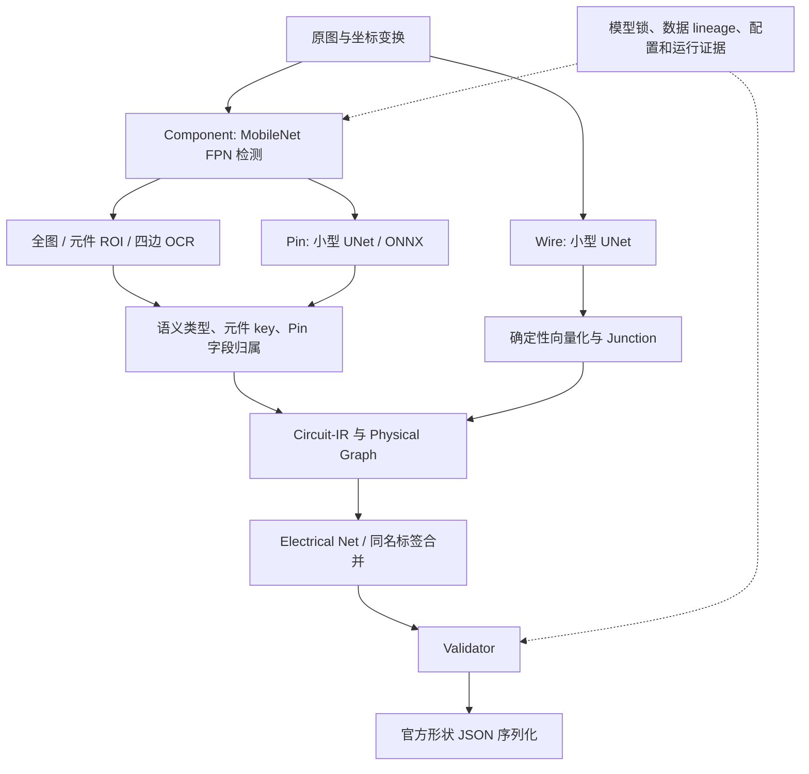

# 项目架构、阻塞点与硬件优化审查

审查日期：2026-09-08。主项目：`E:\EDA挑战题目六`；原 `E:\EDA比赛测试` 历史资料现已归档到 `archive/legacy-training`。

结论：保留现有 Circuit-IR 和四模型架构。第一轮优化应先修复图连接与命名契约、恢复正确的 GPU 执行、统一评测口径，再投入 OCR 与 Component/Pin 的定向训练。当前最主要的问题是端到端信息丢失和模块间规则不一致；扩模型、增加 epoch 或继续扫描全局阈值缺少充分收益证据。

本次新增分析文档与复现材料，没有修改生产源码、模型锁、训练配置或既有评测产物，没有启动训练。

## 1. 阅读范围与证据边界

核对了 README、现有交接指南、最新实施状态、默认/发布候选配置、模型锁、感知适配器、OCR/Pin 关联、Physical Graph、Validator、Serializer、两套评测实现、训练基础设施和 Docker 入口；解析了 8 月 31 日的最新严格/诊断运行，以及原始 split 和 release50 清单。

- 机器可读复核：[evidence.json](E:/EDA挑战题目六/artifacts/audits/architecture_review_20260908/evidence.json)。
- 硬件与本次运行验证：[hardware_runtime.json](E:/EDA挑战题目六/artifacts/audits/architecture_review_20260908/hardware_runtime.json)。
- 可重跑的只读最小复现：[reproduce_contract_findings.py](E:/EDA挑战题目六/artifacts/audits/architecture_review_20260908/reproduce_contract_findings.py)。它描述当前行为，不是通过即代表系统正确的验收测试。
- 本次 76 项既有定向 CPU 测试通过；另外执行了连接和命名的合成反例、一次 Pin ONNX 小输入推理及 Torch 环境 readiness。没有重跑 50 例、完整 Torch 测试或目标容器。
- 下文的精度、严格成功率和整批耗时来自历史产物，不是 9 月 8 日重新测出的全量结果。少数历史产物目录拒绝访问，未尝试修改权限；当前正式锁及本文列出的证据可读取。

## 2. 架构判断

值得保留的部分：统一 IR、坐标恢复和稳定 ID；严格区分 image-only 与 Golden/debug；文件哈希和 bundle lineage；四模型加确定性 Junction；任务级训练、AMP/梯度累积、checkpoint 恢复；Pin 文字已有 Hungarian/有序匹配；空间索引；HTTP 默认单推理槽。

不应重复建设这些基础能力。重点修复接口契约和信息交接，并给现有能力补上真实端到端验收。

## 3. 当前资源与运行事实

| 项目 | 本次核实 | 对落实方案的影响 |
|---|---|---|
| CPU | i5-12500H，12 核、16 逻辑处理器 | 足以运行规则、图算法、诊断和小规模数据处理；线程数应压测，不能按 16 个逻辑核启动 16 个重任务 |
| 系统内存 | 约 16 GB；首次采样可用约 2.2 GiB | 同时启动多套 Torch 进程、缓存全部数据会挤压内存；先限制进程和缓存数量 |
| GPU | RTX 3050 Ti Laptop，4096 MiB | 适合现有轻量模型、小批次、单任务串行训练；显存峰值要计入其他应用和 ORT |
| 显存占用 | 首次采样约 1430 MiB 已占用 | 名义 4 GB 不等于训练可用 4 GB；3 GB 配置上限也不能保证一定够用 |
| E 盘 | 剩余约 26.6 GiB，约 5.7% | 不宜反复复制训练环境、checkpoint 与完整 IR；清理前先列出可回滚候选，不自动删除 |
| Torch 环境 | Python 3.12.14；torch 2.12.1+cu126；CUDA 12.6；cuDNN 9；CUDA 可用 | PyTorch 本身可以使用 GPU |
| Pin ONNX 环境 | onnxruntime-gpu 1.28.0；缺 `cublasLt64_13.dll` | 实测请求 `cuda` 后 session 仅有 `CPUExecutionProvider` |
| 版本管理/容器 | 主目录不是 Git 仓库；本次 PATH 未找到 Docker | 多 agent 修改缺少便捷回滚；目标容器仍需独立环境验收 |

注意：这里只证明 Pin ONNX 回退 CPU，不能把整条流水线都描述为 CPU 推理。历史日志中的“CPU fallback”也不能代替各适配器的实际设备记录。

官方 ORT 文档列出 1.28.x 默认依赖 CUDA 13，而 1.26.x 属于 CUDA 12 系列。建议先在隔离 runtime 环境验证 CUDA 12 兼容的 ORT 精确版本，保留现有 Torch CUDA 12.6；验证 ONNX opset、输出和设备后再锁版本。导入 Torch 或 preload DLL 可以协助加载兼容 DLL，但不能跨 CUDA 主版本解决不兼容。[ONNX Runtime CUDA 兼容表](https://onnxruntime.ai/docs/execution-providers/CUDA-ExecutionProvider.html)

## 4. 已确认的阻塞点

### P0-A：图构建与图校验使用不同的连接判据

代码位置：[physical.py](E:/EDA挑战题目六/src/pcbparse/graph/physical.py:85)、[validation/graph.py](E:/EDA挑战题目六/src/pcbparse/validation/graph.py:21)。

构建器支持端点、共线重叠和共线间隙合并。校验器只重建端点邻接、junction 和 source ID 关系，默认端点容差固定为 3 px，既没有接受构建时的配置，也没有等价检查共线重叠。

本次最小复现：

| 输入 | 构建器结果 | 校验器结果 |
|---|---|---|
| 同一直线 `[0,20]` 与 `[10,30]`，启用 0.75 px 共线重叠 | 一个网络 | 报 `NET.DISCONNECTED_SEGMENTS` |
| 同一直线 `[0,10]` 与 `[15,25]`，启用 6 px gap 合并 | 一个网络 | 报断开；合并是否合理还需要像素证据 |
| 两条远距离线段复用一个 polyline ID | 构建器保留两个网络 | 人为放入同一网络后，校验器未报断开 |

在缓存 0024 的只读诊断中，共线 gap=6 时出现 10 个 disconnected-net；关闭 gap 后变为 0，但网络数从 81 增至 103。这个实验只证明判据影响，不能把“关掉 gap”当成精度提升，更不能据此放宽校验器。

落实：定义共享连接语义；对合法重叠统一几何判据；对间隙要求图像支持及可复核修复证据；禁止仅凭相同 ID 信任远距离预测线段。校验器独立重验几何与证据，不能盲信构建器的 union 结果。

### P0-B：关联层拒绝了输出层明确支持的合法命名

代码位置：[text_component.py](E:/EDA挑战题目六/src/pcbparse/association/text_component.py:24)、[schema.py](E:/EDA挑战题目六/src/pcbparse/validation/schema.py:70)、[official_serializer.py](E:/EDA挑战题目六/src/pcbparse/output/official_serializer.py:87)。

关联层要求 designator 符合“字母+数字”，并按全图字符串唯一进行分配。官方指南及现有 serializer 却支持 `RUN` 等无数字标签，以及重复 designator 的 `_1/_2` 后缀。

即便输入已经是高置信、明确 owner 的正确 OCR，本次复现仍得到：`R1` 成功；`RUN` 被格式拒绝；两个各有独立文字证据的 `R1` 只给其中一个元件赋 key。这是规则缺陷，不依赖重新训练。

落实：把“原始可见 designator”“元件内部 ID”“输出唯一 key”区分清楚；不同元件可以有相同可见标签，同一 OCR token 仍只能支持一个 owner；重复编号留给统一序列化规则。对无数字文本按真实类别和图像上下文判断，不能允许任意字符串随意充当 key。

指南第 14–18 页还允许缺省 pin number 的稳定转换。应保留这一合法行为，同时标注编号来源；它不意味着可以覆盖真实可见 pin number。Serializer 内存在 `UNKNOWN_*` 的缺 key 兜底，应在严格路径保持报错，不能用它制造识别成功。当前正常严格链路会提前阻断缺 key，本文没有把该兜底描述为已绕过正常校验。

### P0-C：运行成功、几何精度和提交成功之间有很大差距

当前锁实际加载 Component v5、旧 OCR resume、Pin v5 和 Wire v5，四项均被标为 blessed。OCR 锁中只有 normalized exact >=0.50 的旧门禁，其 recognizer exact 为 0.5307，detector Hmean 为 0.3669。不是目录名含 v8 就代表加载了 OCR v8。

OCR v8 最终状态是 `gate_failed`：detector Hmean 0.44583，未过 0.45；Component v6 也是 `gate_failed`，mAP50 0.23758。不要等待这些训练完成，或因版本号较大直接替换。部分旧 status 仍写 running，但本次进程快照没有正在运行的 Python 训练；状态文件不能独自证明训练存活。

8 月 31 日的同一批 50 例相关产物：

| 指标 | 缓存诊断基线 | 解释 |
|---|---:|---|
| Component detection F1 | 0.7807 | 几何检测口径，不含全部官方字段要求 |
| Pin detection F1 | 0.5166 | 仍有大量漏检/归属错误 |
| Graph pairwise F1 | 0.2013 | 与官方 net assignment 评分不同 |
| Wire pixel F1 | 0.4768 | Precision 0.3186，Recall 0.9475，误检明显 |
| Component designator exact | 114/650 = 17.54% | 只对 GT 中可评估字段计分 |
| Component value exact | 85/526 = 16.16% | normalized exact 略高，不能代替官方严格字符串 |
| Pin number exact | 72/1508 = 4.77% | 是后续 pin/net 正确匹配的关键障碍 |
| Pin name exact | 10/1423 = 0.70% | 不能只追 Pin 坐标指标 |

来源：[诊断基线](E:/EDA挑战题目六/work/release50-component-assoc-margin0-pinmargin16/reports.json)。它跳过正式成功要求，不能称为 50 张可提交。

对应严格运行是 **0/50 成功**，有 1,699 个 `COMPONENT.MISSING_KEY`、1,681 个 `NET.DISCONNECTED_SEGMENTS`，共 3,380 个 ERROR。另有 17,427 个 Pin target ambiguous 和 6,970 个 unknown，它们是 INFO 诊断次数，不是同等数量的独立错误引脚。[严格基线](E:/EDA挑战题目六/work/production-e2e-componentmargin0-pinmargin16/summary.json)

较新的 pin projection2 实验仍是 0/50；断网 ERROR 只少 1，耗时从约 891 秒增至 1,792 秒。其 perception 耗时也近乎翻倍，不能把全部增时归因于 projection 算法；需要同环境重复测量。[最新严格实验](E:/EDA挑战题目六/work/production-e2e-pin-point-projection2/summary.json)

落实：建立文字检测 → 识别 → 语义类型 → owner → 字段落盘的损失分解；逐层报告 eligible/TP/FP/FN，优先找出正确候选在哪一层消失。现有 Pin 全局匹配已经实现，应先修候选生成、分组和 owner，避免重新实现相同匹配器。

### P0-D：评测集污染与评分口径未闭合

本次直接 join 两个 split 清单，确认 release50 = **30 张原 test + 20 张 val**。实施状态已记载在 release50 上反复比较阈值、选定参数。它现在可以继续作回归和性能演练集，但独立 test 的角色已经失效。重新命名或从已看过的数据中再抽 30 张不能恢复独立性。

评分方面，官方指南按 component key、pin number、必要文本及匹配 net 内的线段评分；案例成绩按案例平均。现有 raw-v1 的 detection/pairwise/pixel 微平均只能定位问题。项目已经有 [official_metrics.py](E:/EDA挑战题目六/src/pcbparse/evaluation/official_metrics.py:41)，应复用它的 guide-v1 matcher；其 `aggregate_reports` 当前合并 TP/FP/FN，应另外补齐固定案例分母、逐例加权平均和失败案例统计，保留明确的非官方标识。

GT 也不完整：这 50 张中只有 650/2155 个元件有可评估 designator，1508/5163 个引脚有可评估 number。必须记录遮罩和缺标，不能把缺标当负样本，也不能用 Golden 填入生产预测。缺少可构造的 expected JSON 时应报告覆盖不足，不制造一个完整“官方分数”。

落实：保留旧 split 及曝光历史；后续参数只在开发集选择；通过新增未曝光工程族或后续独立采集建立外部 holdout。新来源到位前继续修复和回归，同时明确泛化证据限制。

### P1-A：GPU 执行契约和环境版本漂移

代码位置：[torch_pin_adapter.py](E:/EDA挑战题目六/src/pcbparse/perception/torch_pin_adapter.py:312)、[requirements.runtime.lock](E:/EDA挑战题目六/requirements.runtime.lock)、[Dockerfile](E:/EDA挑战题目六/docker/Dockerfile:1)。

Pin 只检查 `get_available_providers()`，没有检查 session 实际启用了什么。实测 `device='cuda'` 也静默回退 CPU。Torch 环境的 runtime readiness 仍为 true，且烟测输出全部为 0，因此 readiness 不能证明各任务在目标 GPU 执行，也不能证明真实识别质量。

Docker 基于 CUDA 12.6，但锁了默认 CUDA 13 的 ORT 1.28，存在同类依赖风险。本机未进行镜像构建，不能宣布容器已实证失败或通过。

落实：显式 CUDA 请求必须验证 session provider，异常应清楚失败；auto 模式允许回退但记录原因。记录 requested/actual device、provider、版本、每模块时延和显存；测试环境、runtime 锁与 Docker 使用同一兼容矩阵。`.venv-test` 与 `.venv-train` 的 NumPy/Pillow/Pydantic 版本也有差异，不能把轻依赖测试通过等同完整运行环境通过。

### P1-B：域差异及训练/推理分布差异

诊断基线中，KiCad 的 Component/Pin/Graph F1 为 0.4131/0.1680/0.0259；其他域明显较高。但 KiCad 只有 2 张，结论应限定为“需要专项复核的薄弱域”，不能据此推断整个域的稳定收益。

Pin 训练使用真实元件 ROI，生产使用预测元件 ROI；当前候选又覆盖了锁内的 boundary prior、margin 和 max detections。Component 存在 512/256 分流，默认配置仍为 1024，Docker 默认加载默认配置。训练指标、生产配置和发布入口必须一一绑定。

落实：先建立按域/尺寸/密集度的漏检与 owner 错误矩阵；用 train 内 out-of-fold 元件预测产生 Pin 训练 ROI，避免用 val/test 做训练物化；审计预测框抖动、padding 和边界目标。KiCad 数据与小目标定向增强优先于全面换成大模型。

### P1-C：严格失败证据和工程协作成本

严格基线中 50/50 失败记录的 `ir_path` 都为 null。[infer_manifest.py](E:/EDA挑战题目六/src/pcbparse/evaluation/infer_manifest.py:397) 已有错误摘要和时间 trace，但缺少同一次严格失败的可回放 IR，迫使调试另跑旁路。

另一份 50 例缓存 IR 合计约 411 MiB，最大单例约 37.3 MiB；长期重复保存完整几何与证据会迅速占用剩余磁盘。现有时间 trace 已显示基线 perception 占阶段总耗时约 92.5%，图构建约 2.6%。应先增加感知内部的分段计时，不能凭函数长度就认定 CPU 图算法是速度主瓶颈。

落实：保留失败状态下的 IR 与已完成阶段，不输出 official JSON；内容寻址缓存和压缩保存详细证据；参数实验优先回放相同感知缓存；建立 Git 或等价的版本快照、明确每个 agent 的文件所有权。模型锁由集成人员统一晋级。

## 5. 适合现有机器的配置起点

以下是待实测的起始方案，不是已验证最优值，也不应直接覆盖正式候选。

| 场景 | 建议起点 | 验证重点 |
|---|---|---|
| GPU 调度 | 同时只运行 1 个训练或批量推理重任务；HTTP 保持 1 个推理槽 | 进程租约/心跳、OOM 恢复、用户现有应用占用 |
| Component 微调 | 复用当前模型；batch=1，累积 4–8；先保留已稳定的 FP32 | FP16 作为独立实验，检查损失有限、检测及导出一致性后采用 |
| OCR / Pin 微调 | 优先从 batch=1–4 开始，维持有效 batch；已有 AMP/GradScaler 继续复用 | CTC 数值稳定、真实字段/owner E2E，不能只看 loss |
| DataLoader | workers=0 作基线，再试 1/2；根据可用 RAM 决定 pinned memory | 吞吐、峰值 RAM、Windows worker 启动开销与恢复一致性 |
| 推理批量 | Pin 当前写死 microbatch=16，建议参数化后比较 1/2/4/8；OCR recognition 先比 8/16 | batch 改动前后预测/顺序一致性，OOM 和延迟 |
| OCR 长文本 | 先按宽度分桶，恢复原始稳定顺序；之后才试减少重复 ROI | 已知 `max_recognition_width=4096`，避免短文本一起补齐到最大宽度 |
| CPU 线程 | 单个重任务先比较 4/6 个 Torch/ORT 线程；普通检查有限并发 | 防止线程超额与可用内存下降 |
| 磁盘 | 新运行设明确产物预算；小实验只保存摘要、差异和失败详细样本 | 正式证据链完整；不删唯一 checkpoint/bundle/原始数据 |
| 大模型辅助 | 当前 Qwen 默认关闭；如后续使用，限定低置信候选、缓存、调用预算与超时 | 原图/文字传输必须遵循比赛与用户授权，不能替代未观察到的证据 |

PyTorch 官方文档支持通过 DataLoader 参数、受控混合精度和梯度累积改善资源使用；本项目已有这些机制，因此建议是测量和配置已有能力，而不是重写训练基础设施。[PyTorch 性能指南](https://docs.pytorch.org/tutorials/recipes/recipes/tuning_guide.html)

## 6. 落实顺序与阶段验收

1. 固定代码/配置/模型/数据基线，声明 release50 已曝光；统一 raw、guide-v1 和 strict 的报告字段。
2. 修复连接契约和命名契约，用合成反例、已有 fixture 和缓存 IR 验证。环境 agent 同期处理 CUDA 依赖，避免占用 GPU 的并发任务。
3. 完成新鲜开发集的损失分解，决定先修 OCR 检测、识别、分类还是 owner；同一轮只改一个主要因素。
4. 针对 Component/Pin 与 KiCad 开展有限训练。使用预测 ROI 的训练方案先做小规模可复现验证，再放大训练。
5. 候选冻结后统一 promotion 和部署入口；严格小套件通过后才做 3×50、坐标、确定性、时间余量及目标机离线演练。

单项优化必须同时给出改善、退化和覆盖分母；减少 ERROR 不能靠删对象、制造 UNKNOWN key 或大范围连线。正式完成标准仍包括严格 JSON 产出、真实字段与拓扑指标、目标环境资源证据；拿到官方 evaluator 后再报告官方成绩。

官方命名及评分依据来自本地赛题指南第 5–8、14–18 页。:codex-file-citation{path="E:/EDA挑战题目六/artifacts/reference/2026_EDA_Challenge_Task6_AI_PCB_Schematic_Official_Guide.pdf" purpose="source"}

可直接派发的任务文本见 [Agent 优化执行 Prompt](E:/EDA挑战题目六/docs/Agent优化执行Prompt_2026-09-08.md)。
