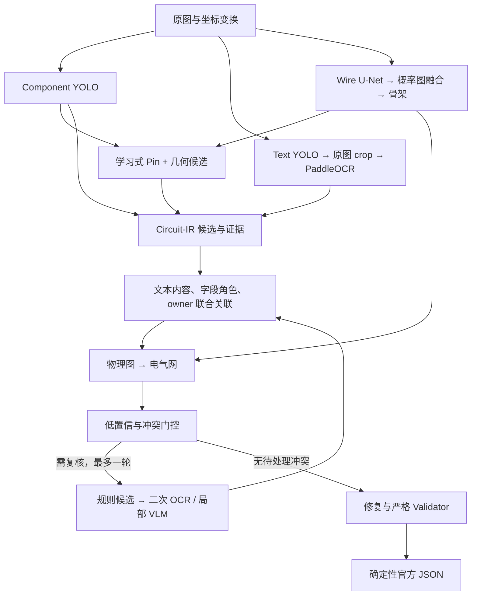

# PCB 原理图解析项目：部署、模型升级与训练手册

版本：1.0 ｜ 编制日期：2026-09-09
项目：E:/EDA挑战题目六
参考论文：PCBnet: A Dataset and Automatic Constructing of SPICE Netlists from Schematic Images，arXiv:2608.27923v1。
适用目标：保留当前 Circuit-IR 工程架构，替换视觉模型、引入论文的局部纠错方法，逐阶段提高器件、文字、引脚及电气网络正确率。

> 本手册是一份实施与部署方案。本次交付没有安装新环境、下载权重、启动训练、替换模型锁或部署服务。标为“待开发”的模块尚不能通过复制命令获得。文中的训练参数与质量门槛是建议起点，不是已测最优配置或精度保证。

## 目录

1. 目标、复现边界与成功标准
2. 当前项目基线
3. 推荐模型与目标架构
4. 硬件与环境部署
5. 数据准备与训练/验证隔离
6. 必须补齐的工程接口
7. 器件检测模型训练
8. 文本检测与 OCR 训练
9. Pin、Wire 与 Junction 优化
10. 论文纠错模块的接入
11. 实验顺序与验收
12. 模型导出、打包及晋级
13. 推理配置与运行
14. Docker、离线交付和上线
15. 运维、回滚及故障处理
16. 里程碑、交付清单和资料索引

## 1. 目标、复现边界与成功标准

### 1.1 “接近论文”需要同时满足三个条件

- 使用可比较的数据和标注覆盖：确认 Dataset300 与作者公开样本的工程来源、图像哈希、标注版本及 split。
- 使用可比较的指标：论文 mAP 未明确 IoU 设置；connectivity accuracy 的误连计分细节和匹配协议未充分披露。
- 使用可运行且有真实评测证据的实现：完成模型适配、数据转换、训练、部署一致性和端到端验收。

作者官方仓库目前只展示 README，并明确称源码受知识产权限制未公开，公开 300 个示例可能与论文实验样本不同。仓库内的预期目录和示例命令不等于已发布实现。工程计划应采用论文方法自行实现；尚不能承诺严格复现论文数字。来源：[作者官方仓库](https://github.com/ECNUACRush/PCBnet)。

### 1.2 论文参考值与本项目目标

| 项目 | 论文报告 | 本项目应报告 | 本手册建议的后期目标 |
|---|---:|---|---|
| 器件检测 | mAP 94.54% | mAP50、mAP50–95、按类别 AP、整图召回 | 先达到 mAP50≥0.85，后续争取≥0.90 |
| 文本检测 | 未单独报告完整检测指标 | IoU=0.5 的 P/R/Hmean、小字/竖字召回 | recall≥0.90，同时 precision≥0.80 |
| OCR 基础链路 | YOLO+PaddleOCR CER 6.33% | GT crop 与预测 crop 分开；字段 exact 单列 | 预测 crop CER≤0.08，后续≤0.0633 |
| OCR 纠错后 | CER 1.43%、WER 3.59%、ACC 98.57% | CER/WER、位号 exact、Pin number exact、覆盖率 | 有充分证据后争取 CER≤0.02 |
| Wire | IoU 93.70% | pixel IoU/F1、skeleton F1、误连/漏连 | pixel IoU≥0.90，且最终 Graph 提升 |
| 网络连接 | connectivity accuracy 84.47% | pin-pair P/R/F1、net-set exact、错误合网/拆网 | 内部 pin-pair F1≥0.80，不能称等价复现 |
| 正式输出 | 未报告本项目 JSON 成功率 | 完整覆盖、严格输出成功率 | 冻结发布套件 100% 通过 |

这些目标是研发目标，不是允许删除难例、缺标字段或降级校验来达标的门槛。指标定义尚未一致时，只能说“内部指标接近目标”，不能说“达到论文精度”。

论文所有表列 ACC 数值都等于 100−CER，且未明确 ACC 的公式。因此 98.57% 不能直接解释为 98.57% 的位号或引脚编号完全正确。论文表 II 中 Tesseract 加入 YOLO 后 CER 从 22.34% 变为 50.84%；检测辅助的收益依赖裁剪与识别器组合，不是普遍保证。来源：[论文](https://arxiv.org/pdf/2608.27923v1)，方法第 2–3 页、表 I–III 第 4 页。

### 1.3 命令状态约定

- **[现有]**：仓库已有入口，命令参数经源码核对；仍需数据、权重和对应依赖。
- **[外部]**：官方工具命令；需先准备固定版本环境、配置及本地权重。
- **[待开发]**：必须先实现并验收。本手册给出契约，不把文件名当作现成工具。
- **[模板]**：需要按已验证结果填写或生成；不能直接当作通过验证的生产配置。

所有输出目录使用新的 run ID。旧权重、原始数据、旧 split 和唯一的历史证据必须保留。

## 2. 当前项目基线

### 2.1 当前生效的模型

权威文件为 models/models.lock.json。configs/models.yaml 中某些占位状态和 README 的旧训练叙述不能替代它。

| task | 当前 bundle | 实际结构 | 格式 |
|---|---|---|---|
| component | train-component-v5-fullmix | Faster R-CNN + MobileNetV3-Large + FPN | model.pt |
| ocr | train-ocr-resume | TinyOCRDetector + TinyCRNN | model.pt |
| pin | train-pin-v5-boundary | TinyPinHeatmapNet | model.onnx |
| wire | train-wire-v5-fresh-allgate | TinyUNet | model.pt |

默认是四任务锁，Junction 使用确定性 vectorizer。启用 learned Junction 后必须改为精确五任务锁，并补齐真实六类验证证据。

冻结模型记录：Component mAP50=0.2501；OCR detector recall=0.2726、Hmean=0.3669、recognizer exact=0.5307；Pin F1@4px=0.6376；Wire skeleton F1=0.9402、connectivity_score=0.5789。这些任务指标不是同一口径的端到端成绩。

### 2.2 已有能力与仍需完成的能力

保留：Circuit-IR、坐标恢复、证据字段、模型哈希与 lineage、文本关联、物理/电气网络分层、Validator、确定性 Serializer、CLI/HTTP、训练 checkpoint 和模型晋级。

近期记录中已完成：构图/校验共线契约修复、部分合法命名与重复位号支持、ONNX 实际 provider 检查、失败 partial IR 保存、OCR batch 参数化。必须用当前代码刷新端到端基线；旧的 0/50 严格结果是历史证据，不是本次实测。

待完成：YOLO adapter 和训练数据转换、可组合 OCR adapter、Paddle 训练数据与配置、预测器件 ROI 的 Pin 训练物化、候选纠错闭环、概率图拼接的协议扩展、外部模型的 candidate bundle 导出。

### 2.3 配置差异不能忽略

- 默认 pipeline.yaml 与 pipeline.release-candidate.yaml 的 tile、阈值、共线容差、Pin prior 和上限不同。
- release-candidate 的 Pin 上限为每元件 12 个；高引脚数 IC 必须审计。
- Pin 锁默认 boundary_band_v2，release-candidate 覆盖为 filled_rect_v1。
- 当前 CLI 不指定 --config 时可能使用 src/pcbparse/resources 中的打包配置。部署、评估始终显式传 --config/--pipeline-config。
- 扩展名为 .yaml 的项目配置由 json.loads 读取：必须使用 JSON 语法。Ultralytics/Paddle 的外部 YAML 则用各自的 YAML 加载器。

## 3. 推荐模型与目标架构

### 3.1 推荐两档模型组合

| 模块 | 本机验证档，历史记录为 4GB GPU | 主训练档，建议约 24GB GPU | 选择依据 |
|---|---|---|---|
| Component | YOLO11n 与现模型对照 | YOLO11s 首选，11m 为第二候选 | 先做预训练微调，比较整图而非仅 tile AP |
| Text detection | YOLO11n，单一 text 类 | YOLO11s，单一 text 类 | 先解决定位；字段类型由关联层判断 |
| OCR recognition | PP-OCRv5_mobile_rec | PP-OCRv5_server_rec，同时保留 mobile 对照 | 成熟预训练识别；验证特殊字符与长文本 |
| Pin | 当前 v5 + 几何候选 | 同结构 base_channels=16/32 对照 + 预测 ROI 训练 | 容量与训练分布分别消融 |
| Wire | 当前 Wire v5 | 先保留 v5；必要时再研究更强 encoder | 已有 BCE+Dice+clDice，先定位拓扑损失 |
| Junction | 确定性算法 | 六类 TinyJunctionClassifier，仅在真实覆盖充分后启用 | 关键是连接/不连接交叉点标注 |
| 纠错 | 本地规则 + 二次 OCR | 规则 + 同一已验证的视觉语言模型服务 | 按需局部复核，保持无外部服务也能运行 |

YOLO11n/s/m 是同一系列的选项，并非论文明确指定的型号。PaddleOCR v5 的具体型号也是本手册工程选型，不是作者已披露配置。选用这些模型是为了建立可控对照，不能按版本号判定必然更优。参见 [YOLO11](https://docs.ultralytics.com/models/yolo11/)、[PaddleOCR recognition](https://www.paddleocr.ai/main/en/version3.x/module_usage/text_recognition.html)。

### 3.2 目标 dataflow



图是逻辑依赖。4GB 本机使用一个 GPU 工作队列，不同时驻留、训练多套重模型。现有生产代码会逐个加载并持有四个 provider；按阶段加载/释放是待开发能力，不能只在文档里写“串行”就认为已解决驻留内存。

## 4. 硬件与环境部署

### 4.1 硬件分工

历史观测：i5-12500H、约 16GB RAM、RTX 3050 Ti Laptop 4GB。它适合接口开发、小规模训练、缓存评估与部署验证。正式比较 server OCR、较大 YOLO 和多轮训练，建议使用约 24GB GPU、32–64GB RAM 的 Linux 单 GPU 主训练环境。后者是资源规划建议，不是最低硬性要求；显存峰值必须实测，不按模型文件大小估计。

训练机工作目录可采用 /workspace/pcbparse；本机仍使用 E:/EDA挑战题目六。原始路径不能硬编码进可移植 bundle。先准备足够磁盘容纳数据、缓存和 best/last checkpoint；本机旧审计曾显示 E 盘较紧张，开始前重新查看。

### 4.2 先冻结现状 [现有]

PowerShell：

```powershell
Set-Location -LiteralPath 'E:\EDA挑战题目六'
$ErrorActionPreference = 'Stop'
$env:PYTHONPATH = Join-Path (Get-Location) 'src'
$env:PYTHONUTF8 = '1'
$TrainPython = (Resolve-Path '.\.venv-train\Scripts\python.exe').Path
$TestPython = (Resolve-Path '.\.venv-test\Scripts\python.exe').Path
$RunId = 'pcbnet-upgrade-' + (Get-Date -Format 'yyyyMMdd-HHmmss')
$AuditDir = Join-Path 'artifacts\deployment-audit' $RunId
New-Item -ItemType Directory -Path $AuditDir -Force | Out-Null
Get-FileHash models/models.lock.json,configs/pipeline.yaml,configs/pipeline.release-candidate.yaml -Algorithm SHA256 |
    ConvertTo-Json | Set-Content -Encoding utf8 (Join-Path $AuditDir 'baseline-hashes.json')
& $TrainPython -m pip freeze --all |
    Set-Content -Encoding utf8 (Join-Path $AuditDir 'original-environment.txt')
if ($LASTEXITCODE -ne 0) { throw 'pip freeze failed' }
nvidia-smi
```

环境快照保存在本地，分享前检查是否包含私人包源 URL。不打印 API key 或环境变量全集。

### 4.3 三个环境分开建立 [模板]

| 环境 | 用途 | 依赖策略 |
|---|---|---|
| pcbparse-train-yolo | YOLO 训练和导出 | 匹配 CUDA 的 PyTorch/torchvision + 固定 ultralytics/onnx 版本 |
| pcbparse-train-ocr | PaddleOCR 训练和导出 | 固定 PaddleOCR commit、PaddlePaddle 及其 CUDA 依赖 |
| pcbparse-runtime | 四任务推理、关联和服务 | 项目依赖 + 经导出验证的 Torch/ORT；Paddle backend 或独立 worker 二选一 |

不要在原 .venv-train 上直接升级整套依赖。首先在隔离环境安装所选官方版本，运行真实推理和一小步反向传播，再生成精确锁。以下命令依赖这些新锁已由环境验证生成：

```bash
# 模板：在 Linux 主训练机的项目根执行
python3.12 -m venv .venv-yolo
.venv-yolo/bin/python -m pip install -r requirements.yolo.verified.lock
.venv-yolo/bin/python -m pip check
.venv-yolo/bin/python -m pip install --no-deps -e .
```

requirements.yolo.verified.lock、requirements.paddle.verified.lock 和 requirements.runtime.verified.lock 是待产生文件，当前仓库没有。它们必须包含精确版本、平台、Python/CUDA/cuDNN 信息；不能用“安装最新版”代替。

现有 runtime 锁为 torchvision 0.27.1、ORT GPU 1.28.0，Docker base 是 CUDA 12.6。官方 ORT 矩阵将 1.28.x 列为 CUDA 13；因此原 Docker/依赖组合需要修正并重新验证。可选择保留 CUDA 12 路线、验证对应 ORT 版本，或整体迁移兼容的 CUDA 13 路线；不能只更换 DLL。建议第一轮保留已工作的 Torch CUDA 主版本，隔离验证 ORT 1.26.x 或其他 CUDA 12 对应版本，并检查 ONNX IR/opset。参见 [ORT CUDA 矩阵](https://onnxruntime.ai/docs/execution-providers/CUDA-ExecutionProvider.html)。

### 4.4 环境验收

- Python 与 pip 来自同一环境，pip check 无冲突。
- Torch 的 CUDA 可用；运行真实模型 forward/backward，无 NaN、OOM。
- ONNX session 的 get_providers() 实际包含所请求的 GPU provider；“可用 provider 列表”不足以证明已经启用。
- Pin 在真实尺寸 384×384 和实际 batch 上执行，不能仅用白图 session 加载当作精度证明。
- 记录每个 adapter 的 requested/actual device、峰值显存、输入形状和时延。
- Paddle 与 Torch 不在一个 4GB GPU 进程里同时建立不可控的大内存池。
- 启动任何训练前，用 20–50 个代表性 crop/tile 做有边界的烟测；烟测产物不得晋级。

## 5. 数据准备与训练/验证隔离

### 5.1 原始数据和现有派生数据

现有根目录：Dataset300/Dataset300。当前派生版本：data/derived/dataset300-v2。现有 grouped split：240 train / 30 val / 30 test。

实际派生记录数：Component 12,789；OCR 48,464；Pin 29,648；Wire 14,895；Junction 41,962。这些是任务记录数，不能直接与论文的实例统计对比。尤其“300 张”不能作为与论文同一数据集的证据。

[现有] 优先验证现有数据，而非重新生成覆盖它：

```powershell
& $TrainPython -m pcbparse.training.preflight_cli --config configs/train/dataset300_v2_torch.json --workspace-root .
if ($LASTEXITCODE -ne 0) { throw 'Dataset lineage preflight failed' }
```

只有从原始数据重新建库时才使用：

```powershell
& $TrainPython -m data_tools.pcbnet_ingest --dataset-root Dataset300/Dataset300 --output data/manifests/dataset300.jsonl --expected-count 300
& $TrainPython -m data_tools.audit --dataset-root Dataset300/Dataset300 --output artifacts/audits/dataset300_audit.json
```

每条命令检查退出码。已有同名产物先确认保留，禁止盲目覆盖。在新版本目录派生数据后，训练配置中的所有 lineage 哈希要通过工具重算；不能手填旧哈希蒙混通过。

### 5.2 独立评测与缺标处理

release50 包含原 test 30 张和 val 20 张，并已参与参数选择：继续作为回归/性能集，不能作为独立 test。重新命名不会恢复独立性。

最优方案是新增未参与选型的工程族作为外部 holdout；到位之前，按工程族做内部交叉验证并清楚标注范围。重复、近重复和同工程不同渲染全部放在同一 split。阈值、字符规则、纠错 few-shot、候选上限只用 train/dev 决定。

缺失 designator/Pin number 不作负样本；训练和评估记录 eligible、masked、原因及分母。OCR 原始字符串保存大小写、下划线和单位；任何归一化都另报指标。source component ID 如 C_1 不是自动可用的可见位号，必须依据真实文本关联字段。

### 5.3 YOLO 数据转换器 [待开发]

建议文件：data_tools/export_yolo_dataset.py。建议产物：

```text
data/derived/pcbnet-upgrade-v1/
  component_yolo/images/{train,val}/...
  component_yolo/labels/{train,val}/...
  component_yolo/dataset.yaml
  component_yolo/classes.json
  text_yolo/images/{train,val}/...
  text_yolo/labels/{train,val}/...
  text_yolo/dataset.yaml
  text_yolo/classes.json
  tile_manifest.jsonl
  conversion_audit.json
```

契约：

1. 按 source_image 汇总记录，先继承整张图的 split，再切片。
2. Component 类别映射到连续 0..K−1；classes.json 双向绑定原始 category_id/name，不能把当前 TorchVision 1..N 直接作为 YOLO 标签。
3. YOLO 行格式为 class_id cx/W cy/H w/W h/H，坐标基于实际 tile，不是原图。
4. Text 首轮使用单一 text 类。记录 details 等语义字段用于关联监督，不能把密集小类先分散成稀疏检测类别。
5. 每个 tile 保存原图 ID、原图 SHA、crop 坐标、缩放、变换和包含对象 ID。
6. 保留足够 overlap；边缘被截断的文字不能拿“半截图+完整文字”训练 recognizer。对于 detector 的截断框，明确可见比例策略。未标注目标仍出现在图里时，不能随意当作纯负样本。
7. 真负样本应无目标且标注覆盖可信；缺标区域使用排除策略。YOLO 标准检测损失不天然支持任意 ignore mask，需要在转换器中处理或扩展 trainer。
8. 跨 tile 重复预测还原到整图后统一 NMS；验证要同时报告 tile 与原图指标，选型以原图为主。
9. 检查 50 张代表性切片的标注叠图；自动检查零面积框、越界、非法 class、重复 ID、跨 split 工程泄漏。

### 5.4 PaddleOCR 数据转换器 [待开发]

建议文件：data_tools/export_paddle_rec_dataset.py。

从 ocr_text.jsonl 读取 source_image、bbox、content、split，原图裁剪；同时保留标注框 crop 和训练集预测文字框匹配到 GT 的 crop。输出：

```text
ocr_rec/crops/...
ocr_rec/train_list.txt
ocr_rec/val_list.txt
ocr_rec/crop_manifest.jsonl
ocr_rec/charset_audit.json
```

list 的每行是“相对图片路径 + TAB + 原始字符串”。文本含 TAB/换行时必须有明确处理与审计，不能悄悄破坏格式。标注为空、不可读、越界 crop 单独统计。

优先保留预训练字符字典及 head 对齐；统计 Ω、μ、µ、±、下划线、斜杠、连字符的覆盖。扩字典时维护旧字符索引并处理新 head 初始化，不能随机重建整个字典而声称完整继承预训练。长文本长度、CTC 时间步及 NRTR max_text_length 一并检查。不要静默丢弃默认 max_text_length 外的长 Pin name。

增强仅作用于 train：轻微模糊、缩放、对比度、与真实域匹配的压缩噪声。禁止镜像文字。90°/270° 方向候选需与裁剪坐标变换一致。

### 5.5 Pin 预测 ROI 与 Junction 标注

Pin 训练补充训练集内部 out-of-fold 器件预测 ROI：某训练工程的预测框由未训练过该工程的检测器生成，再通过 GT 进行监督匹配。验证始终使用正常预测框，不能用 GT ROI 替代生产结果。

Junction 必须补齐 endpoint、t_junction、connected_cross、non_connected_cross、bend、noise 六类真实验证支持。synthetic 可以增强 train，但不能顶替真实 val/test。对模糊交叉点保留 UNKNOWN，人工裁决后重物化。


## 6. 必须补齐的工程接口

### 6.1 实施清单

下列新路径是建议落点，当前未实现。先完成单模块离线实验，再让统一适配器进入主链路。

| 编号 | 新增/修改文件 | 必须产出 | 验收 |
|---|---|---|---|
| D1 | data_tools/export_yolo_dataset.py | 两类 YOLO 数据、classes 和 tile manifest | 原图 split 不泄漏、坐标可逆、叠图正确 |
| D2 | data_tools/export_paddle_rec_dataset.py | OCR crop、list、字符与长文本审计 | 原文无意外清洗，裁剪完整 |
| M1 | perception/yolo_component_adapter.py | ComponentProvider 实现 | 类型/坐标/类别映射和 NMS 一致 |
| M2 | perception/composable_ocr_adapter.py | YOLO text + Paddle recognizer 组合 | TextToken 协议与 overrides 均兼容 |
| M3 | training/external_bundle_export.py | 外部模型 candidate bundle | 全文件哈希、导出对齐、真实 val evidence |
| P1 | perception/hybrid_pin_provider.py | learned/geometry 候选融合 | 同一 Pin 不重复、owner 正确、无编号猜测 |
| A1 | association + ir/models.py | 联合候选、字段/owner 分数 | 重复文字、跨 ROI、多字段不冲突 |
| R1 | reasoning/tasks.py / orchestrator.py | 低置信非空字段纠错、修改日志 | 改错率可测、受影响关联重算 |
| W1 | protocols.py / torch_wire_adapter.py / composite_provider.py | 概率图输出与重叠融合 | 原图坐标一致、缝隙减少、误合网不增 |
| E1 | evaluation 增量 | 端到端字段、误合网/拆网、逐例汇总 | 固定分母、失败案例计入 |
| O1 | runtime 锁、Docker、配置 | 可移植 release 包 | 离线启动、实际 GPU、三次回放 |

模块位于 src/pcbparse 下，表中 perception/training 等为其子目录。

### 6.2 保持现有 provider 协议

当前协议见 [protocols.py](E:/EDA挑战题目六/src/pcbparse/perception/protocols.py)。

```python
# 接口契约示意，不是新增实现
ComponentProvider.predict(image: ImageView, ctx) -> list[Component]
OCRProvider.recognize(views: list[ImageView], ctx) -> list[TextToken]
PinProvider.predict(component_views: list[ComponentView], ctx) -> list[Pin]
WireProvider.segment(views: list[ImageView], ctx) -> list[WireMask]
```

生产加载器调用 factory(resolved_model_path, entry_copy)，适配器必须有 version 属性。不能把 factory 写成只接收 config 的签名。

Component 返回坐标必须属于输入 ImageView，随后现有 composite_provider 负责变回原图。若 adapter 已经还原到原图，外层会二次变换。检测器内部 letterbox 的逆变换在 adapter 内完成，tile 到原图的变换在外层完成。

OCR adapter 必须把文本框绑定输入 view_id，保留 raw_text、候选、置信度和 evidence。不同 ROI 内识别到同一文字只是一份物理文本的多条证据，不可重复分配。预测框分数与识别分数分别记录，不用随意相乘后的单一分数掩盖来源。

现有 production_provider 会应用 detector_threshold、vertical_rotation_enabled 等 OCR override。新 adapter 必须支持对应属性/配置接口，或明确改造配置解析；只实现 recognize 方法不足以保证可加载。

### 6.3 多模型 OCR 仍登记为一个 ocr task

保持四任务锁：component、ocr、pin、wire。OCR 内部可以有 detector 和 recognizer 两个文件；不把 text_detector 添加成未受支持的顶层第五 task。

推荐 OCR 主 artifact 为 composite-model.json 描述文件，模型权重、字典、预处理参数全部作为 bundle-relative 依赖，逐个 SHA-256 绑定到 evidence_attachments。现有 kind 是字符串，可明确命名为 model_dependency、charset、preprocessing。适配器还需独立验证 descriptor 中列出的依赖恰好被哈希覆盖；禁止 descriptor 指向 bundle 外文件。该 descriptor adapter/导出逻辑属于 M2/M3 待开发内容。

所有推理资源必须本地存在；加载不应触发模型下载。预训练权重在准备阶段下载、核验并记录来源，而不是运行时补齐。

### 6.4 Wire 概率图协议不能偷换

当前 WireMask.mask 是二值输出，torch_wire_adapter 在内部已经阈值化。若要“先融合概率图再骨架化”，必须新增可选 probabilities 字段或新方法，并验证外层支持。禁止在现有 mask 字段里直接塞浮点数组，让旧代码把非零值全当 True。

重叠融合采用带权平均，权重在边缘逐渐减小；显式维护有效像素覆盖与累计权重，边界处不能除零。大图用窗口与 halo，跨窗口保留相同全局坐标。融合完成再用冻结阈值二值化、骨架化和矢量化。

### 6.5 模型参数改变时的兼容性

当前 torch_backend 为各 task 绑定固定 architecture。把配置 architecture 改为 yolo11s 不会得到 YOLO 训练，必须走外部 trainer + 自定义 adapter/bundle，或显式扩展 backend。

Pin 的 pin_base_channels 已有配置项；由 16 改 32 会改变权重形状，不能严格加载旧 v5 checkpoint。首轮优先在 16 通道上做预测 ROI 训练；扩容实验需要明确的初始化/蒸馏策略并重新导出，不伪装为普通 resume。

## 7. 器件检测模型训练

### 7.1 数据与初始化

1. 完成 D1，固定 component_yolo/dataset.yaml、classes.json、tile_manifest。
2. 训练初始化使用官方 COCO 预训练 YOLO11 权重，检测 head 根据 PCB 类别重新训练；COCO 类别不能直接当 PCB 类别。
3. 将权重放入 models/pretrained/yolo11s.pt，记录真实 SHA-256、来源及许可。
4. 训练配置必须显式控制增强、seed、输入尺寸、batch、epoch、optimizer 和验证策略。

### 7.2 24GB 主训练档 [外部，依赖 D1]

Linux 项目根执行；假设已验证的 YOLO 环境安装完成，本地初始化文件存在：

```bash
.venv-yolo/bin/yolo detect train \
  model=models/pretrained/yolo11s.pt \
  data=data/derived/pcbnet-upgrade-v1/component_yolo/dataset.yaml \
  imgsz=1024 epochs=120 patience=20 batch=8 device=0 workers=4 \
  optimizer=AdamW lr0=0.0003 weight_decay=0.0005 \
  seed=20260909 deterministic=True amp=True cache=False \
  fliplr=0.0 flipud=0.0 degrees=0.0 \
  hsv_h=0.0 hsv_s=0.0 hsv_v=0.1 \
  mosaic=0.1 mixup=0.0 close_mosaic=10 \
  project=work/pcbnet-upgrade name=component-y11s-v1 exist_ok=False
```

这是建议的第一组配置，batch=8 和 1024 不保证在所有 24GB 环境装入。先用相同配置的短 smoke 检查峰值，再执行正式训练。官方 trainer 参数依据：[Ultralytics training](https://docs.ultralytics.com/modes/train/)。

现有工程图的切片生成是训练数据转换的一部分。imgsz=1024 不等于把整张原理图直接缩成 1024。建议材料保留 512/1024 两档候选；尺寸对照单独实验，禁止同时换模型、改 tile、改 NMS 然后只报一个增益。

### 7.3 4GB 本机档

- 首选 yolo11n、本地 512–640 tile、batch=1、workers=0，初始 AMP 必须经数值 smoke。
- 不为了放入更大模型而把小文字和细线缩没。
- 不在 Ultralytics CLI 中杜撰 gradient_accumulation 参数；如需精确有效 batch，核对固定版本 trainer 的实现、nbs 和 optimizer steps。
- 4GB 上 server OCR 与 YOLO 不同时训练。长训练可在主训练机完成，导出的候选再送回本机做部署验证。

### 7.4 验证与 checkpoint 选择

```bash
.venv-yolo/bin/yolo detect val \
  model=work/pcbnet-upgrade/component-y11s-v1/weights/best.pt \
  data=data/derived/pcbnet-upgrade-v1/component_yolo/dataset.yaml \
  split=val imgsz=1024 batch=1 device=0
```

Ultralytics best.pt 默认按其内置 fitness 选择，未必是你的整图/端到端最优候选。外层应保存有明确 epoch 对应关系的候选，在固定 dev 上做原图拼接、类别映射和后处理后再选择。

候选恢复试验：主尺度 + 局部小 tile 补检，在原图坐标统一融合。当前回退逻辑会用小 tile 结果替换主尺度结果；改为合并必须单独验证重复误检和大器件碎片化。

选型记录：mAP50/mAP50–95、按类别 AP、小器件召回、按域分层、每图 FP、器件 key exact、owner-aware Pin recall 和最终 Graph。至少保留 YOLO11n/s 与原模型同协议比较，11m 仅在 s 的不足确由容量导致时继续。

## 8. 文本检测与 OCR 训练

### 8.1 文字检测 [外部，依赖 D1]

```bash
.venv-yolo/bin/yolo detect train \
  model=models/pretrained/yolo11s.pt \
  data=data/derived/pcbnet-upgrade-v1/text_yolo/dataset.yaml \
  imgsz=1024 epochs=120 patience=20 batch=8 device=0 workers=4 \
  optimizer=AdamW lr0=0.0003 weight_decay=0.0005 \
  seed=20260909 deterministic=True amp=True cache=False \
  fliplr=0.0 flipud=0.0 degrees=0.0 \
  hsv_h=0.0 hsv_s=0.0 hsv_v=0.1 mosaic=0.0 mixup=0.0 \
  project=work/pcbnet-upgrade name=text-y11s-v1 exist_ok=False
```

文字检测优先召回，但必须同时约束误检。把导线、边框和器件符号作为有可靠标注的困难背景。评估小字、竖排、密集引脚编号、跨 tile 字符和长标签；记录框是否裁掉字符首尾。需要旋转框时先验证 axis-aligned crop 的实际损伤，再增加 OBB，不一开始扩大输出协议。

### 8.2 OCR 四组对照，先识别再微调

A=旧 detector+旧 recognizer；B=旧 detector+Paddle；C=YOLO detector+旧 recognizer；D=YOLO detector+Paddle。

首先用固定模型在缓存裁剪上比较 PP-OCRv5_mobile_rec 与 server_rec。若预训练已明显改善，再进行 PCB 微调。论文没有证明 server 一定优于 mobile，在真实字段上选择。

Paddle 训练环境使用固定版本源码；与 pip 推理包分别锁版本。训练配置来源：[PP-OCRv5 mobile config](https://github.com/PaddlePaddle/PaddleOCR/blob/main/configs/rec/PP-OCRv5/PP-OCRv5_mobile_rec.yml)，[官方识别训练流程](https://github.com/PaddlePaddle/PaddleOCR/blob/main/docs/version3.x/module_usage/text_recognition.en.md)。

### 8.3 配置准备 [模板，依赖 D2]

在固定 commit 的 PaddleOCR 源码目录，从对应官方配置复制成 configs/rec/PCB/pcb_rec_server.yml。必须检查：

| 项 | 建议起点 |
|---|---|
| Architecture | 完整保留所选 PP-OCRv5 的 backbone/head，不手写简化替代 |
| pretrained_model | 匹配型号的本地训练权重 .pdparams |
| character_dict_path | 预训练字典，先做覆盖审计 |
| Train/Eval data_dir | 数据转换器输出的绝对路径或固定相对路径 |
| label_file_list | train_list.txt / val_list.txt |
| epoch_num | 60，按 dev 保存最优；不是保证需要跑满 |
| learning_rate | 0.00005，作为微调起点 |
| Train/Eval batch | 主训练档先 16/16；本机 mobile 从 1–4 起 |
| sampler.first_bs | 如采用 MultiScaleSampler，必须一起修改 |
| image_shape / sampler.scales | 保持预训练高度，宽度按 PCB 长文本分布检查 |
| max_text_length | 用 train 文本统计确定，并检查所有解码 head |
| workers | 主训练档 2–4，本机 0 |
| augmentation | 无镜像；审计 RecConAug 的拼接是否符合当前目标 |
| validation | 保存字段角色、域、长度、原图 ID 分层结果 |

Paddle config 中 YAML anchor、sampler.first_bs 和 loader.batch_size_per_card 可能共同决定 batch。只改一处可能仍按官方大 batch 启动。

### 8.4 训练、评估、导出 [外部]

以下在固定的 PaddleOCR 源码目录执行，python 必须属于 pcbparse-train-ocr 环境：

```bash
python tools/train.py \
  -c configs/rec/PCB/pcb_rec_server.yml \
  -o Global.pretrained_model=/workspace/pcbparse/models/pretrained/PP-OCRv5_server_rec_pretrained.pdparams \
     Global.save_model_dir=/workspace/pcbparse/work/pcbnet-upgrade/ocr-server-v1

python tools/eval.py \
  -c configs/rec/PCB/pcb_rec_server.yml \
  -o Global.pretrained_model=/workspace/pcbparse/work/pcbnet-upgrade/ocr-server-v1/best_accuracy

python tools/export_model.py \
  -c configs/rec/PCB/pcb_rec_server.yml \
  -o Global.pretrained_model=/workspace/pcbparse/work/pcbnet-upgrade/ocr-server-v1/best_accuracy \
     Global.save_inference_dir=/workspace/pcbparse/work/pcbnet-upgrade/ocr-server-v1/inference
```

best_accuracy 是官方常见 checkpoint 前缀示例；实际以固定版本训练输出为准，先验证文件存在。续训使用同版本 Global.checkpoints 及 optimizer 状态，不能把 warmstart 误称精确 resume。

导出的 Paddle 静态模型不能直接交给现有 torch_ocr_adapter。第一版可使用本地 Paddle backend 的新 adapter；若转换 ONNX，单独验证图算子、动态宽度、字典、预处理和逐字符输出。转换成功并不等于结果一致。4GB 如采用 OCR CPU/独立 worker，明确延迟预算和 IPC 的 view_id/crop 哈希，不把大图片来回重复传输。

### 8.5 裁剪与解码规则

- 原图分辨率裁剪并适度 padding，避免截掉下划线和边缘笔画。
- 竖排/疑难 crop 比较 0°、90°，必要时 270°，保留每路坐标与来源。
- 按宽度分桶，避免短词统一补到最长宽度；不静默截断长文本。
- 原始 raw_text 永久保留，normalized_text 和 correction 独立。
- 允许 top-k，但不能根据 GT 做选择。规则候选必须来自 train 定义的字符混淆和领域知识。
- 同时报告 GT crop 识别、预测 crop 识别、原图字段 exact。检测漏掉的文字在端到端统计中计为漏失，不能从分母消失。

## 9. Pin、Wire 与 Junction 优化

### 9.1 Pin 先改训练分布，再扩容量

路线 P0：现有 v5 作为冻结基线。
路线 P1：16 通道结构 + out-of-fold 预测 ROI + bbox 抖动 + 高 Pin 数类别审计。
路线 P2：32 通道容量对照，需要新的初始化；与 P1 使用相同数据。
路线 P3：HybridPinProvider 融合有笔画/导线证据的几何候选。

输入 384×384、stride=4 可先保持。384 缩放若使密集 IC 相邻引脚只剩极少像素，需要比较更大 ROI 分辨率或边条带分块，不能只增加通道数。

现有训练器的基础命令 [现有]：

```powershell
& $TrainPython -m pcbparse.training.torch_train_cli --config configs/train/dataset300_v2_pin_v5_boundary.json --task pin --output work/pcbnet-upgrade/pin-baseline-smoke --workspace-root . --device cuda --precision fp16 --smoke
if ($LASTEXITCODE -ne 0) { throw 'Pin smoke failed' }
```

这是旧配置烟测，需其 warmstart checkpoint 存在，不代表完成 P1/P2。新训练需要生成 configs/train/pcbnet_pin_predroi_v1.json 并重新绑定派生数据、summary 与所有哈希；然后先 preflight、smoke，再去掉 --smoke 正式训练：

```powershell
# 模板：新数据物化及配置实现、验收后执行
& $TrainPython -m pcbparse.training.preflight_cli --config configs/train/pcbnet_pin_predroi_v1.json --workspace-root .
if ($LASTEXITCODE -ne 0) { throw 'Pin data preflight failed' }
& $TrainPython -m pcbparse.training.torch_train_cli --config configs/train/pcbnet_pin_predroi_v1.json --task pin --output work/pcbnet-upgrade/pin-predroi-v1 --workspace-root . --device cuda --precision fp16
```

Pin 默认仅检测位置与方向，编号仍来自 OCR。几何方法不得凭“电阻通常两脚”制造两个已经确认的 Pin。高引脚数 IC 的候选上限应由类别和可信 train 分布制定，记录截断前后计数。

### 9.2 Wire 保留基线，集中解决误连

现有 TinyUNet 已有 BCE、Dice、clDice。不要重复把“加 clDice”作为未实施创新。

首先固定同一批 mask/IR，分别检查：
- 分割误把文字或器件笔画当导线；
- tile 边缘重复骨架、偏移或断裂；
- 相交但不连接的 crossing 被合并；
- Pin 点离正确导线较远或吸到邻近导线；
- 同名标签错误合并不同网络。

试验 W1：概率图融合后骨架化。
试验 W2：间隙修补需要原图/概率图路径支持，限制跨越长度与方向改变。
试验 W3：Pin 接入联合考虑 tip/base/方向/局部导线走向，保留未接入选项。

现有 _union_collinear_fragments 主要依赖几何。加入像素证据需要扩展构图输入或在 IR 内保存可验证的 gap evidence。Validator 独立检查同一契约，不盲信 union ID。降低 ERROR 数不能靠关闭检查、拆散所有网络或将所有近邻相连。

### 9.3 Junction

首轮维持 deterministic_vectorizer，避免引入未充分标注的第五模型。对真实“连接十字/跨越十字”进行补标后，训练当前 TinyJunctionClassifier 作为局部分类器对照。启用 learned 模型必须完成六类 coverage、混淆矩阵、导出对齐及五任务晋级，不将 three-class macro F1 代替六类结果。

## 10. 论文纠错模块的接入

### 10.1 先建立轻量知识库 [待开发]

推荐版本化 JSON/YAML，起步不必部署向量数据库：

- 字符混淆：0/O、1/I/l、5/S、8/B、下划线缺失。
- 字段格式：位号、阻容值、器件型号、Pin number/name、网络标签分别定义。
- 类别兼容：R/C/L/U 等仅作为证据，不排斥合法无数字标识。
- 局部布局：相对方向、距离、引脚顺序和器件边界。
- 来自 train 的纠错例子，带规则版本和来源；不从 holdout 错误回填。

同一器件可以有 key/value/name 多个文本，唯一性按字段及物理文本实例定义。两个不同位置的 R1 不应按字符串相同被折叠。类别相同也不代表可以覆盖原图清晰文字。

### 10.2 新增 TextHypothesis 与 CorrectionProposal [待开发]

建议字段：token_id、crop_id/hash、raw_text、candidate_text、role、owner_candidates、det_score、rec_score、rule_evidence、model_version、transform、decision_status。

修改提案还要保存 old_value、new_value、reason、affected_ids、accepted/rejected。禁止让 LLM 直接返回整份 Circuit-IR 或随意改几何坐标。保护高置信已确认字段，低置信非空字段必须走提案比较而不是原地覆盖。

### 10.3 门控与一次重算

先用 dev 估计“需要重读”和“可以接受改写”的概率，不能直接比较 OCR 分数和 VLM 自报分数。

流程：初步关联/图 → 检测歧义 → 本地规则候选 → 二次 OCR → 必要时局部 VLM → 校验提案 → 重算受影响关联、物理图和电气网 → 最终 Validator。最多一轮，防止循环更改。

初始预算可沿用项目每图 3 次、输入合计 3000 token、单次输出 64 token、12 秒超时。扩展结构化提案后若 64 token 不够，应更新预算并评估延迟，而不是截断 JSON。请求失败、预算耗尽时保留原始证据和未知状态，不伪造确定结果。

### 10.4 外部模型接入与环境变量

论文仅举例 GPT-4.1 / GPT-5.4 的局部图像复核，没有完整披露固定模型快照、prompt、温度和成本；因此不能声称使用某个具体模型即复现论文。

当前项目已有 HTTPQwenReasoner，但它的候选选择协议不等于完整纠错服务。选择一个已验证支持局部图像和所需结构化响应的服务，锁定模型 ID 与 prompt 版本；兼容性通过实际请求验证。

当前环境变量支持 QWEN_ENDPOINT、QWEN_MODEL、QWEN_API_KEY；另有 PCBPARSE_QWEN_ENABLED 控制 profile 后的开关。仅写 pipeline.enabled=true 可能被 profile 覆盖。无外部服务基线可使用：

```powershell
$env:PCBPARSE_QWEN_ENABLED = '0'
```

启用实验时，在会话/密钥管理中提供真实 endpoint、model、key，不写入本文或提交的模型包。涉及图像发送时保留调用范围和数据使用约束，第一版只发送疑难局部 crop。配置解析和 profile 覆盖后，记录脱敏的最终有效配置；原始 key 不进入日志或审计快照。

### 10.5 纠错验收

报告：路由数、改对数、改错数、拒绝数、未覆盖数、缓存命中、超时、每图调用数、费用/延迟。所有纠错后指标必须基于同样输入分母；前后都保留无服务版本。最终净收益以字段 exact 和网络指标决定，不以“调用了 Agent”作为完成标准。


## 11. 实验顺序与验收

### 11.1 固定基线，再逐项替换

| 实验 | 唯一主要改动 | 保持固定 | 主要判断 |
|---|---|---|---|
| B0 | 当前代码重跑默认配置 | 当前四任务锁 | 最新基线，与旧报告分开 |
| B1 | 当前代码重跑 release-candidate | 当前四任务锁 | 配置收益/退化 |
| O1 | 仅替换 recognizer | detector、后处理、关联 | 预测 crop 与字段 exact |
| O2 | 仅替换 text detector | recognizer、关联 | 文字召回、裁剪损失 |
| O3 | 组合新 detector+recognizer | 关联、Pin/Wire | OCR E2E 和位号/Pin 字段 |
| C1 | 替换 Component | 选定 OCR、Pin/Wire | owner-aware Pin 与 Graph |
| P1 | 预测 ROI 训练及 Hybrid Pin，分开测 | Component/OCR/Wire | 引脚召回和误连 |
| A1 | 联合语义/owner 评分 | 全部视觉输出缓存 | 归属与字段 exact |
| W1 | 概率图融合/连接证据，分开测 | 视觉权重 | 错误合网/拆网 |
| R1 | 规则纠错 | 前面冻结 | 改对/改错、字段 exact |
| R2 | 局部视觉复核 | 相同纠错预算 | 净收益、时延和费用 |

不同模型结构本身是对照变量；不同分辨率、增强和后处理变化另做消融。每个候选至少在固定 dev 上比较，最终用未参与选择的工程族验证。若采用三随机种子，报告每个 seed 和均值/范围，不能只挑最高值。

### 11.2 当前端到端基线命令 [现有]

PowerShell，沿用第 4 章的路径和解释器变量：

```powershell
$EvalDir = Join-Path 'work\pcbnet-upgrade' ('baseline-val-' + (Get-Date -Format 'yyyyMMdd-HHmmss'))
& $TrainPython -m pcbparse.evaluation.infer_cli --dataset-root Dataset300/Dataset300 --split-manifest data/splits/dataset300_split.jsonl --split val --models-lock models/models.lock.json --pipeline-config configs/pipeline.release-candidate.yaml --profile competition --output-dir $EvalDir
$EvalExit = $LASTEXITCODE
Write-Output ('evaluation exit=' + $EvalExit)
```

此命令可能因当前模型质量而退出 1。检查 summary.json、predictions.jsonl、每例状态和 partial IR；失败案例必须计入总分母。环境/模型门禁失败通常退出 2，应先修环境或包问题，不解释为精度差。

raw-v1 定位指标：

```powershell
& $TrainPython -m pcbparse.evaluation.raw_cli --prediction-manifest (Join-Path $EvalDir 'predictions.jsonl') --dataset-root Dataset300/Dataset300 --split-manifest data/splits/dataset300_split.jsonl --split val --output (Join-Path $EvalDir 'raw-v1.json')
```

若 raw evaluator 拒绝失败行或部分 IR，应先明确其覆盖契约并补齐失败统计，不能删除失败行后声称全量精度。official_metrics.py 是项目的指南口径实现，不是赛会官方 evaluator；字段 exact、逐案例宏平均和 net-set 指标需由 E1 补充完整报告。

scripts/run_raw_candidate_batch.py 是跳过严格 Serializer 的诊断旁路，而且不等价于完整纠错流水线。不能把其生成的 IR/报告称为可提交 JSON，也不能用它评估 R1/R2 的完整效果。

### 11.3 建议阶段门槛

以下是内部研发验收建议，修改门槛必须在实验前记录。

| 阶段 | 建议验收 |
|---|---|
| 接口可用 | 坐标 round-trip≤0.5px；全部协议正确；模型文件与字典无缺项 |
| 视觉第一轮 | Component 原图 mAP50≥0.80；Text recall≥0.85；预测 crop CER≤0.10 |
| 语义第一轮 | designator exact≥0.80、Pin number exact≥0.70；同时报告 coverage |
| 图第一轮 | pin-pair precision 和 recall 都≥0.70，严格输出成功率相对基线上升 |
| 后期目标 | 按第 1 章阈值继续提升；不允许靠降低 coverage 达标 |
| 发布 | 冻结套件严格通过、无新增误合网重大退化、资源/离线/确定性通过 |

当某个阶段未通过，先做 oracle 分解诊断：仅在离线评估中分别使用 GT text、GT component、GT Pin、GT wire，观察 Graph 改善幅度以定位瓶颈。必须标记 oracle，不能把 GT/sidecar 引入生产预测。

### 11.4 完整报告最小字段

code commit/hash、resolved config hash、model lock hash、所有权重 hash、source/split hash、seed、运行环境、每例用时、峰值 RAM/VRAM、requested/actual device、成功/失败及原因、eligible/masked 分母、分域/分尺寸结果、原图检测指标、字段 exact、pin-pair P/R/F1、net-set exact、误合网/拆网数、纠错收益。

论文未提供的指标不自行命名为“官方分数”。类数、IoU、字符串规范化、预测数量限制和逐例/微平均设置随报告一起冻结。

## 12. 模型导出、打包及晋级

### 12.1 导出前后必须比较

YOLO 导出示例 [外部]：

```bash
.venv-yolo/bin/yolo export \
  model=work/pcbnet-upgrade/component-y11s-v1/weights/best.pt \
  format=onnx imgsz=1024 dynamic=True opset=17 simplify=False
```

是否采用 ONNX 取决于实际导出一致性和目标运行环境；PyTorch backend 也可以通过新 adapter 使用。text detector 独立导出。固定是否含 NMS；避免导出端、adapter、外层重复执行不一致的 NMS。

对至少 32 个代表性输入比较 eager/export 的输出，包含小字、竖字、长宽比、大 IC、空白背景和密集导线。除最大张量误差外，检查：
- bbox 坐标、类别和筛选后候选是否一致；
- OCR 最终字符串、方向和字典索引是否一致；
- Pin 坐标偏差、方向、候选数是否一致；
- Wire 阈值附近像素变化及图连接是否变化；
- 同一图最终 JSON 与关键指标是否出现不可接受变化。

不沿用旧 Pin 的 0.1 tensor tolerance 作为所有模型通用门槛；阈值应和输出语义对应。

### 12.2 Candidate bundle [待开发 M3，复用现有框架]

每 task 包至少包含模型 artifact、model_card.json、bundle.manifest.json、真实 val 预测、训练配置哈希、数据/split 哈希、gate policy、导出一致性和 adapter 导入证据。

复用 pcbparse.training.artifacts.finalize_candidate_bundle，而不是手工拼一个 blessed 锁。artifact 先在 bundle 内生成，然后通过真实评估和导出检查产生证据。

推荐发布目录：

```text
models/releases/pcbnet-upgrade-v1/
  component/...
  ocr/...
  pin/...
  wire/...
  models.staging.json
  models.lock.json
  promotion-report.json
  release-evaluation.json
```

新 Component/OCR 与保留的 Pin/Wire 必须能证明相同评测基准。若新增数据改变了 canonical dataset_config_hash 或 split，不能直接混入旧 bundle 并伪改哈希：需对保留模型重新验证并生成真实对应的新 bundle。辅助 YOLO/crop 数据可绑定原始 canonical v2 lineage，再额外哈希转换 manifest；必须由导出器明确支持和验证。

### 12.3 两层晋级，避免把 runtime-ready 当 release-ready

第一层是模型包“可加载的候选锁”；第二层是整套系统“可正式发布”。现有 production loader 要求 blessed，因此端到端候选评估需要先通过工具生成一个隔离路径下的 promoted candidate lock。它不替换主锁，也不表示正式发布完成。

[现有 CLI + 待生成 bundle] 先创建 unblessed staging：

```powershell
$ReleaseDir = 'models/releases/pcbnet-upgrade-v1'
New-Item -ItemType Directory -Path $ReleaseDir -Force | Out-Null
& $TrainPython -m data_tools.model_promotion --bundle "$ReleaseDir/component/bundle.manifest.json" --bundle "$ReleaseDir/ocr/bundle.manifest.json" --bundle "$ReleaseDir/pin/bundle.manifest.json" --bundle "$ReleaseDir/wire/bundle.manifest.json" --junction-mode deterministic_vectorizer --production-config configs/pipeline.pcbnet-v1.yaml --output "$ReleaseDir/models.staging.json"
if ($LASTEXITCODE -ne 0) { throw 'Staging failed' }
```

模型评估、导出和 fixture 均通过后，生成隔离候选锁：

```powershell
& $TrainPython -m data_tools.model_promotion --bundle "$ReleaseDir/component/bundle.manifest.json" --bundle "$ReleaseDir/ocr/bundle.manifest.json" --bundle "$ReleaseDir/pin/bundle.manifest.json" --bundle "$ReleaseDir/wire/bundle.manifest.json" --junction-mode deterministic_vectorizer --production-config configs/pipeline.pcbnet-v1.yaml --promote --output "$ReleaseDir/models.lock.json" --report-output "$ReleaseDir/promotion-report.json"
if ($LASTEXITCODE -ne 0) { throw 'Candidate runtime promotion failed' }
```

configs/pipeline.pcbnet-v1.yaml 是待冻结配置。工具拒绝覆盖既有输出；重做时使用新 release ID，不能先删除证据再重用路径。

启用 learned Junction 时，增加第五 bundle，使用 --junction-mode learned_model，并提供 --human-review-evidence。不能用四任务锁搭配 learned_junctions_enabled=true。

## 13. 推理配置与运行

### 13.1 最终配置 [模板]

从已评估的配置复制并命名 configs/pipeline.pcbnet-v1.yaml；新模型的最佳分数阈值不能照抄旧模型。至少明确：

| 配置 | 冻结要求 |
|---|---|
| component tile / overlap | 与训练材料和原图评估对应 |
| component score / NMS / max candidates | 从 dev 校准；记录被截断对象 |
| OCR detector_threshold | 独立校准新检测器 |
| OCR batch / vertical_rotation | 与新 adapter 的实际处理一致 |
| Pin input/prior/margin/max | 与训练和类别策略一致 |
| Wire threshold/融合策略 | 与最终 Graph 一起校准 |
| graph 各容差 | builder 与 validator 同一契约 |
| labels | SIGNAL/POWER/GROUND 分开决定 |
| qwen/纠错 | 开关、模型、预算、prompt 与规则版本 |
| validation | require_zero_errors=true，extra fields forbid |

第一轮 learned Junction 关闭。图容差不能通过大幅增大来追求“所有引脚都接上”。新增 hybrid/correction/probability_fusion 配置项需要先扩展解析与运行代码，不能默默忽略未知字段。

### 13.2 Runtime smoke [现有]

```powershell
$NewLock = 'models/releases/pcbnet-upgrade-v1/models.lock.json'
$NewConfig = 'configs/pipeline.pcbnet-v1.yaml'
$RuntimePython = (Resolve-Path '.\.venv-runtime\Scripts\python.exe').Path
$env:PCBPARSE_QWEN_ENABLED = '0'
& $RuntimePython -m pcbparse.cli healthcheck --require-ready --config $NewConfig --models-lock $NewLock
if ($LASTEXITCODE -ne 0) { throw 'Runtime not ready' }
```

.venv-runtime 需由第 4 章构建完成。healthcheck 检查真实 adapter 加载和 smoke，但不能证明真实图像质量；下一步必须跑代表性案例。

### 13.3 单图 [现有]

```powershell
& $RuntimePython -m pcbparse.cli infer --input Dataset300/Dataset300/0001/0001-KiCad.png --output outputs/pcbnet-v1-smoke --config $NewConfig --profile competition --provider production --models-lock $NewLock --fail-fast
```

--output 是目录。示例 0001 是训练/诊断案例，不是未曝光测试。任何单图成功也不能代替完整评测。

### 13.4 冻结批量评测 [现有]

对新增 holdout 使用已完成的数据 manifest；下例仍是已知 val，只用于开发：

```powershell
& $RuntimePython -m pcbparse.evaluation.infer_cli --dataset-root Dataset300/Dataset300 --split-manifest data/splits/dataset300_split.jsonl --split val --models-lock $NewLock --pipeline-config $NewConfig --profile competition --output-dir work/pcbnet-upgrade/release-val-run1
```

固定代码、配置、模型，在同一目标环境运行三次，每次新目录。比较各案例最终 official JSON 的字节与 SHA-256；时间戳、诊断 metadata 或完整 IR 不要求字节相同，但业务输出必须满足确定性协议。若启用外部 VLM，需对冻结响应缓存进行确定性回放，并另报在线服务稳定性；不能宣称外部生成天然逐字节稳定。

### 13.5 HTTP 服务 [现有]

```powershell
& $RuntimePython -m pcbparse.cli serve --host 127.0.0.1 --port 8080 --input-root Dataset300/Dataset300 --output-root outputs/api-pcbnet-v1 --config $NewConfig --profile competition --provider production --models-lock $NewLock
```

另一个 PowerShell 窗口：

```powershell
Invoke-RestMethod -Uri 'http://127.0.0.1:8080/health'
Invoke-RestMethod -Uri 'http://127.0.0.1:8080/ready'
$RequestBody = @{ input='0001/0001-KiCad.png'; output='0001.json' } | ConvertTo-Json
Invoke-RestMethod -Uri 'http://127.0.0.1:8080/v1/infer' -Method Post -ContentType 'application/json' -Body $RequestBody
```

请求只接收输入根下的相对路径。保持单推理槽或受控队列，批量与 HTTP 不竞争同一小显存 GPU。/health 是进程存活；/ready 是运行就绪；质量发布验收由外部报告管理。

### 13.6 提交包 [现有]

只有 infer_cli 生成的成功 production evaluation 目录才进入提交打包：

```powershell
& $RuntimePython -m pcbparse.output.submission_cli --evaluation-dir work/pcbnet-upgrade/release-val-run1 --output-dir outputs/submission-pcbnet-v1 --archive outputs/submission-pcbnet-v1.zip --audit artifacts/audits/submission-pcbnet-v1.json
```

不能把 partial IR、debug JSON 或诊断 raw 路径打包成正式结果。提交前使用赛会提供的 schema/sample/evaluator；缺少官方工具时明确记录“指南口径验证，未获官方评分”。

## 14. Docker、离线交付和上线

### 14.1 修正现有 Docker 入口

现有 docker/Dockerfile：
- base CUDA 12.6 与 ORT 1.28 默认 GPU 包存在主版本不匹配；
- COPY models 会带入多个历史 release，镜像体积可能过大；
- build 阶段运行 --require-ready；若 adapter 强制 CUDA，常规无 GPU build 会失败；
- 默认 pipeline.yaml 不等于经过评估的 release-candidate；
- .dockerignore 排除了一些模型锁变体，必须检查新锁确实进入构建上下文。

修改必须与 runtime verified lock 和发布包一起验证，不能只更改镜像 tag。新模型 adapter 的 Python 包和所有依赖都应包含在镜像中。

### 14.2 推荐构建流程 [模板]

1. 在目标 Linux/CUDA 环境验证全部模型，得到精确 requirements.runtime.verified.lock。
2. 锁文件中排除开发机器的 editable 路径；本项目源码单独安装。保持 pyproject 核心依赖一致，若确需修改，重新验证并版本化。
3. 收集与目标 OS/Python/架构匹配的 wheelhouse。Windows wheel 不能用于 Linux 镜像。
4. 发布目录只保留此次四任务所需完整 bundle，重新生成相对路径锁；不引用 work 或宿主机绝对路径。
5. 基础镜像使用已验证 digest。build 做静态完整性检查，run --gpus all 做实际 GPU 验证。
6. 记录镜像 digest 与 release 的代码/config/model hashes。

Dockerfile 设计模板，文件需由 O1 实施后使用：

```dockerfile
ARG VERIFIED_BASE
FROM ${VERIFIED_BASE}
ENV PYTHONDONTWRITEBYTECODE=1 PYTHONUNBUFFERED=1 PYTHONHASHSEED=0
WORKDIR /app
COPY wheelhouse/ /wheelhouse/
COPY requirements.runtime.verified.lock /app/
RUN python -m pip install --no-index --find-links=/wheelhouse -r requirements.runtime.verified.lock
COPY pyproject.toml README.md /app/
COPY src/ /app/src/
COPY data_tools/ /app/data_tools/
COPY configs/ /app/configs/
COPY models/releases/pcbnet-upgrade-v1/ /app/models/releases/pcbnet-upgrade-v1/
RUN python -m pip install --no-deps --no-build-isolation .
RUN mkdir -p /data/input /data/output
EXPOSE 8080
CMD ["python","-m","pcbparse.cli","serve","--host","0.0.0.0","--port","8080","--input-root","/data/input","--output-root","/data/output","--config","/app/configs/pipeline.pcbnet-v1.yaml","--profile","competition","--provider","production","--models-lock","/app/models/releases/pcbnet-upgrade-v1/models.lock.json"]
```

VERIFIED_BASE 必须提供已验证完整镜像引用，含 sha256 digest；基础环境需有 pip/setuptools/wheel、所需 CUDA/cuDNN 及共享库。wheelhouse 构建是独立受控准备步骤，不能假设一次 pip download 在任意宿主机就能解析全部 CUDA wheel。上面是待实施模板，不是本次已构建镜像。

### 14.3 构建和 GPU 验证 [模板]

Linux 项目根：

```bash
# 先在 shell 中设置真实 VERIFIED_BASE；冒号表达式会在未设置时停止
docker build --build-arg VERIFIED_BASE="${VERIFIED_BASE:?set verified base image digest}" \
  -f docker/Dockerfile.pcbnet -t pcbparse:pcbnet-v1 .

docker run --rm --gpus all --network none \
  --entrypoint python pcbparse:pcbnet-v1 \
  -m pcbparse.cli healthcheck --require-ready \
  --config /app/configs/pipeline.pcbnet-v1.yaml \
  --models-lock /app/models/releases/pcbnet-upgrade-v1/models.lock.json
```

Dockerfile.pcbnet 是按上节实施的待生成文件。构建完成后执行代表性真实图片离线推理，而不仅 healthcheck。逐文件故意缺失/篡改的负例应拒绝启动；测试在临时副本中进行。

### 14.4 本地服务部署 [模板，镜像通过后]

```bash
docker run -d --name pcbparse-pcbnet-v1 --gpus all --init \
  --restart unless-stopped -p 127.0.0.1:8080:8080 \
  -e PCBPARSE_QWEN_ENABLED=0 \
  -v /srv/pcbparse/input:/data/input:ro \
  -v /srv/pcbparse/output-v1:/data/output \
  pcbparse:pcbnet-v1
```

/srv 下目录由管理员按目标机实际路径准备。离线验收用 --network none 跑一次批量 CLI；有在线 VLM 的配置属于另一发布变体，应单独验收网络失败行为。对外服务时配置认证、TLS、限流和大小/超时限制；单纯的项目调试 HTTP 不承担这些能力。

镜像 HEALTHCHECK 或外部编排 readiness 探针需要访问 /ready，并给冷启动足够时间。生产探针不应频繁重复整套模型 smoke 导致资源竞争。

### 14.5 发布前系统门禁

- 完整冻结套件（通常 30–50 张，按任务要求确定）三次运行，全部输入有状态记录。
- 严格 Validator 为零 ERROR；未通过案例不能用 debug/degraded 绕过。
- components/pins/nets 顶层格式正确，稳定排序、原图坐标和唯一 key 规则通过。
- 无 GT/sidecar 访问；模型、规则及纠错例子无 holdout 泄漏。
- 最终字段与网络指标达到预先冻结的门槛，并记录相对基线退化。
- P95、总耗时和峰值资源低于比赛/服务预算，建议预留至少 20% 时间余量；这是工程建议。
- 目标机实际 CUDA 执行、离线权重加载、镜像 digest 与代码/config/lock 一致。
- 必要时使用 scripts/audit_release_hard_gates.py 汇总；先 --help 查看当前要求，所有外部证据路径真实存在。

## 15. 运维、回滚及故障处理

### 15.1 监控

每图记录 image_id/hash、模型版本、耗时分段、对象候选/过滤数、字段缺失数、Pin orphan/ambiguous 数、网络数、错误合网风险信号、Validator codes、Qwen 调用结果和设备。

按域、密度、小字比例抽样回看原图叠图。原始输入 hash 和输出 hash 建立追溯；详细 IR 可以压缩、按内容寻址，保留失败代表样本。API key 不进入 IR、日志、配置快照或 bundle。

### 15.2 不可变发布与回滚

每个 release 保留：代码版本、精确环境锁、镜像 digest、完整模型包、运行配置、规则/prompt 版本、评估报告。正式服务通过启动参数选择整套 release，不分别替换几个 model.pt。

推荐先让新版本监听 8081，回放固定输入；检查 /ready、输出哈希、指标和延迟后再切流。回滚时恢复上一组镜像+模型锁+配置+规则，输出写入单独目录，避免新旧 schema/配置混写。

不自动覆盖 models/models.lock.json。若维护单一生产指针，应由发布流程原子切换并保存前一版本；不能只改 blessed=true。

### 15.3 故障排查

| 现象 | 先检查 | 处理 |
|---|---|---|
| CUDA 可用但 Pin 很慢 | ONNX session 实际 providers | 修正 ORT/CUDA/cuDNN，并用真实模型验证 |
| 新 YOLO 无器件或类别错 | 0-based 类别映射、letterbox、RGB/BGR | 固定 tile 对照 eager 输出，检查 classes.json |
| 单 tile 好，整图差 | 变换重复、跨 tile NMS、截断框 | 画原图叠图，做原图指标 |
| OCR 小字漏检 | tile 分辨率、检测阈值、裁剪覆盖 | 优先改善文字入口，避免靠识别器猜 |
| OCR 微调后乱码 | 字典/head 不匹配、预处理、字符索引 | 恢复匹配字典，检查导出前后字符串 |
| 长 Pin name 丢失 | max_text_length、动态宽度、CTC/NRTR | 明确处理长文本，不静默截断 |
| IC 只出少量引脚 | max_detections、ROI resize/prior | 审计候选截断和像素间距 |
| Wire 分割高分但 Graph 差 | crossing、Pin 吸附、tile 接缝、同名标签 | 分别做 oracle 诊断和误合网/拆网分析 |
| 纠错无效果 | 是否被 profile 关闭、是否生成 task | 记录有效配置与路由原因，检查非空字段支持 |
| 纠错改坏结果 | 不可比置信度、类别过强约束 | 校准接受阈值，保留原值与拒绝选项 |
| healthcheck 通过但提交失败 | 真实字段和图质量 | 执行 infer_cli，查看失败 partial IR |
| Docker build 找不到锁 | .dockerignore、COPY 范围、相对路径 | 检查构建上下文，使用完整 release 子目录 |
| Docker 离线启动下载模型 | adapter 默认模型名或遗漏依赖 | 全部改为验证过的本地路径，禁止运行时补下载 |
| 训练很久仍无 candidate | gate_failed、导出误差、缺 eval evidence | 查看正式终态，不把 checkpoint 当已晋级 bundle |

## 16. 里程碑、交付清单和资料索引

### 16.1 实施里程碑

| 阶段 | 依赖 | 完成物 |
|---|---|---|
| S0 冻结与环境 | 现有代码和数据 | 新基线、环境 verified locks、运行设备报告 |
| S1 数据转换 | S0 | YOLO/Paddle 材料、坐标与缺标审计 |
| S2 OCR 对照 | S1 | 四组实验、mobile/server 选择、字段分解 |
| S3 器件升级 | S1/S2 | YOLO 对照、整图评估、新 adapter |
| S4 Pin 与关联 | S2/S3 | 预测 ROI、Hybrid Pin、联合归属 |
| S5 拓扑与纠错 | S4 | 概率图/连接证据、局部纠错净收益 |
| S6 打包与部署 | S2–S5 已冻结 | 四任务候选锁、目标容器、三次回放和回滚包 |
| S7 论文对照 | 独立数据与指标协议 | 可比较结果；条件不足则保留限定结论 |

可以先完成无需 GPU 的接口和材料检查，但同一台 4GB GPU 上重任务串行。不要根据固定天数承诺完成训练；实际时长由图片尺寸、batch、数据规模和模型决定。

### 16.2 每个模型必须交付

- 原始预训练来源、许可、下载时间和 SHA-256。
- 完整训练配置、源码 commit、依赖锁、随机种子、数据与 split hashes。
- best/last checkpoint、真实验证预测、分层结果和失败样例。
- eager/export 一致性、适配器协议测试、原图坐标验证。
- candidate bundle、model card、所有依赖与字典的哈希。
- 新旧模块的相同协议对照，包含退化和资源开销。
- 端到端报告，且不是仅在 GT crop/GT ROI 上的指标。

### 16.3 本次手册交付范围

已完成：阅读项目代码、现有配置/模型锁、训练与评估 CLI、论文方法和表格、官方工具文档；编写本手册；对关键现有入口运行 --help；检查手册结构和引用。

未执行：安装新依赖、数据重物化、YOLO/Paddle adapter 开发、模型训练、GPU 精度实验、模型锁晋级、Docker 构建或服务上线。因此本手册里的候选模型尚未证明优于当前模型，论文目标尚未达成。

### 16.4 关键源码

- [模型锁](E:/EDA挑战题目六/models/models.lock.json)
- [感知协议](E:/EDA挑战题目六/src/pcbparse/perception/protocols.py)
- [生产加载器](E:/EDA挑战题目六/src/pcbparse/perception/production_provider.py)
- [感知编排](E:/EDA挑战题目六/src/pcbparse/perception/composite_provider.py)
- [主流水线](E:/EDA挑战题目六/src/pcbparse/pipeline/orchestrator.py)
- [关联入口](E:/EDA挑战题目六/src/pcbparse/association/ocr.py)
- [推理任务生成](E:/EDA挑战题目六/src/pcbparse/reasoning/tasks.py)
- [物理图](E:/EDA挑战题目六/src/pcbparse/graph/physical.py)
- [模型包契约](E:/EDA挑战题目六/src/pcbparse/training/artifacts.py)
- [模型晋级](E:/EDA挑战题目六/data_tools/model_promotion.py)
- [批量 image-only 评估](E:/EDA挑战题目六/src/pcbparse/evaluation/infer_cli.py)
- [提交包 CLI](E:/EDA挑战题目六/src/pcbparse/output/submission_cli.py)
- [历史架构审计](E:/EDA挑战题目六/docs/架构阻塞与硬件优化审查_2026-09-08.md)

### 16.5 外部来源

查阅日期均为 2026-09-09；动态文档实施时应绑定 commit/版本，而不是依赖未来 main 的默认值。

1. [PCBnet 论文 v1](https://arxiv.org/pdf/2608.27923v1)：架构、实验与消融；用户提供的本地文件为 E:/我的文档/Downloads/2608.27923v1.pdf。
2. [PCBnet 作者仓库](https://github.com/ECNUACRush/PCBnet)：源码未公开和示例数据与实验数据可能不同的说明。
3. [Ultralytics YOLO11](https://docs.ultralytics.com/models/yolo11/)：候选模型系列。
4. [Ultralytics training](https://docs.ultralytics.com/modes/train/)：训练入口与参数。
5. [PaddleOCR recognition](https://www.paddleocr.ai/main/en/version3.x/module_usage/text_recognition.html)：识别器与训练/导出。
6. [PaddleOCR 识别训练源码说明](https://github.com/PaddlePaddle/PaddleOCR/blob/main/docs/version3.x/module_usage/text_recognition.en.md)：Paddle 命令及权重类型。
7. [PaddleOCR mobile 配置](https://github.com/PaddlePaddle/PaddleOCR/blob/main/configs/rec/PP-OCRv5/PP-OCRv5_mobile_rec.yml)：字典、sampler 和 batch 的实际字段。
8. [ONNX Runtime CUDA](https://onnxruntime.ai/docs/execution-providers/CUDA-ExecutionProvider.html)：CUDA/cuDNN 兼容矩阵与实际 provider 验证。
